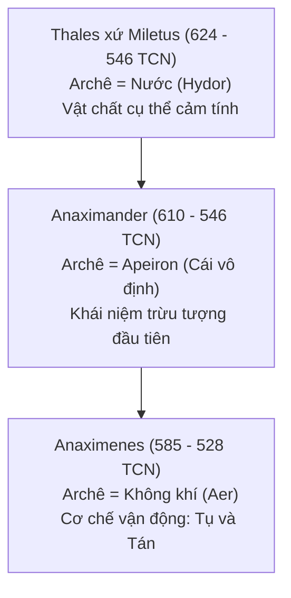
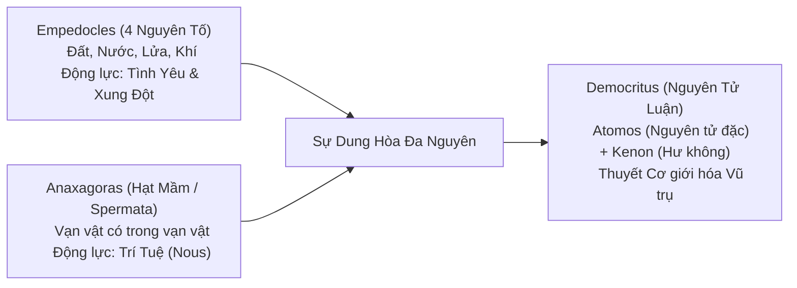

# CHUYÊN KHẢO HÀN LÂM 01: SỰ KHỞI SINH CỦA LOGOS VÀ BẢN THỂ LUẬN TIỀN SOCRATES

> **Mã chuyên đề:** PHIL-101-HIST  
> **Cấp độ:** Dự khoa / Nhập môn chuyên sâu (Propaedeutic / Undergraduate Foundations)  
> **Phạm vi học thuật:** Thế kỷ VI – V TCN tại Ionia và Magna Graecia (Đại Hy Lạp)  
> **Văn bản nguồn quy chuẩn:** *Die Fragmente der Vorsokratiker* (Diels-Kranz - DK); Aristotle, *Metaphysics* Quyển A (Alpha); Theophrastus, *Physikon doxai*.  
> **Thuật ngữ bản thể cốt lõi:**  
> - $\alpha\rho\chi\eta$ (*Archê*): Bản nguyên đầu tiên, cội nguồn tối hậu của vạn hữu.  
> - $\lambda o\gamma o\varsigma$ (*Logos*): Lý tính phổ quát, ngôn từ chân thực, quy luật nội tại điều phối vũ trụ.  
> - $\phi\upsilon\sigma\iota\varsigma$ (*Physis*): Tự nhiên như một tiến trình tự sinh thành và vận động.  
> - $\alpha\pi\epsilon\iota\rho o\nu$ (*Apeiron*): Cái vô định, vô tận, không biên giới.  
> - $\kappa o\sigma\mu o\varsigma$ (*Cosmos*): Trật tự vũ trụ hài hòa, đối lập với Chaos (sự hỗn mang).

---

## 1. BỐI CẢNH LỊCH SỬ & CUỘC ĐOẠN TUYỆT TRI THỨC LUẬN (THE EPISTEMOLOGICAL BREAK)

### 1.1. Khủng hoảng của Thế giới quan Thần thoại (Mythos)
Trước thế kỷ VI TCN, tâm thức của người Hy Lạp hoàn toàn bị bao bọc bởi **Mythos (Thần thoại)** thông qua hai trước tác kinh điển của Homer (*Iliad* và *Odyssey*) và Hesiod (*Theogony* - Gia phả thần linh). Trong thế giới quan này:
- Tự nhiên không có tính tự trị: Mọi hiện tượng vật lý đều được quy kết về ý chí nhân hình (*Anthropomorphism*) của các vị thần trên đỉnh Olympus. Sấm sét là do Zeus phẫn nộ; bão biển là do Poseidon nổi giận; bệnh dịch là mũi tên trừng phạt của Apollo.
- Cấu trúc nhân quả mang tính ngẫu hứng và bất tất: Con người chỉ có thể cầu nguyện, cúng tế để xoa dịu các thần linh, hoàn toàn không có khả năng dự đoán hay thấu hiểu quy luật tự nhiên bằng lý trí.

### 1.2. Miletus: Chiếc nôi địa lý - xã hội của tư duy duy lý
Sự ra đời của triết học không phải là một sự kiện tình cờ mang tính thần bí, mà gắn liền với điều kiện lịch sử tại **Miletus** (thành phố cảng trù phú của vùng Ionia, nay thuộc Thổ Nhĩ Kỳ):
- **Sự giao lưu thương mại và văn hóa đa dạng:** Miletus là cửa ngõ nối liền Hy Lạp với các nền văn minh cổ đại Ai Cập, Lưỡng Hà, Ba Tư. Sự tiếp xúc với các nền văn hóa ngoại lai đã làm lung lay tính tuyệt đối của các thần thoại địa phương.
- **Sự phát triển của tri thức kỹ thuật thực dụng:** Thiên văn học Babylon và hình học Ai Cập được các thương nhân Miletus tiếp thu, nhưng thay vì phục vụ tôn giáo cúng tế như ở phương Đông, người Hy Lạp đã trừu tượng hóa và duy lý hóa chúng thành các quy luật phổ quát.
- **Sự trỗi dậy của Polis (Thành bang) và Văn hóa Tranh biện Công khai:** Thể chế dân chủ sơ khai tại các thành bang Hy Lạp đòi hỏi các công dân phải dùng lập luận logic để thuyết phục người khác tại tòa án và quảng trường (*Agora*), tạo thói quen tư duy phản biện.

---

## 2. TRƯỜNG PHÁI MILETUS: TRUY TÌM NGUYÊN LÝ BẢN NGUYÊN (ARCHÊ)

Triết học phương Tây chính thức khởi đầu khi con người thôi không hỏi *"Vị thần nào làm ra điều này?"* mà chuyển sang câu hỏi: **"Bản chất tối hậu cấu tạo nên vạn vật (Archê) là gì?"**.



### 2.1. Thales xứ Miletus: Nước và Mầm mống của Thuyết Nhất nguyên Vật chất
- **Luận đề trung tâm:** *Nước (Hydor) là Archê của muôn loài; vạn vật sinh ra từ nước và khi suy tàn lại trở về với nước; Trái đất nổi trên mặt nước*.
- **Phân tích tri thức luận của Aristotle (*Metaphysics* 983b):** Thales đi đến nhận định này thông qua quan sát thực nghiệm sinh học:
  1. Hạt mầm của sự sống luôn ẩm ướt; thức ăn nuôi dưỡng muôn loài đều chứa độ ẩm.
  2. Nước là chất duy nhất có thể quan sát trực tiếp biến đổi qua 3 trạng thái vật lý: Khí (hơi nước), Lỏng (nước), Rắn (băng).
- **Ý nghĩa triết học:** Giá trị của Thales không nằm ở câu trả lời "Nước" (dưới góc nhìn hóa học hiện đại là sai), mà nằm ở **tiền đề phương pháp luận mang tính cách mạng**: Lần đầu tiên trong lịch sử, một người đã giải thích Tự nhiên bằng chính Tự nhiên, quy vô số hiện tượng đa tạp về **Một nguyên lý thống nhất (Monism - Nhất nguyên luận)**.

### 2.2. Anaximander: Bước nhảy vĩ đại lên Sự Trừu Tượng với Khái niệm "Apeiron"
Anaximander nhận ra một mâu thuẫn logic nghiêm trọng trong học thuyết của Thales:
- **Nghịch lý các mặt đối lập:** Thế giới cấu tạo bởi các mặt đối lập tiêu diệt lẫn nhau (Nước lạnh ẩm dập tắt Lửa nóng khô). Nếu Archê là Nước, thì Nước với bản tính ẩm ướt không bao giờ có thể sinh ra Lửa, và lẽ ra Nước đã nuốt chửng Lửa từ lâu!
- **Định đề Apeiron (ἄπειρον):** Bản nguyên tối hậu không thể là một chất vật lý cụ thể nào (vì bất kỳ chất cụ thể nào cũng bị giới hạn bởi các thuộc tính đối lập). Archê phải là **Apeiron** – cái vô định, vô tận, không biên giới, trung tính và vĩnh cửu.
- **Đoạn phân đoạn DK 12 B1 (Văn bản triết học cổ nhất còn sót lại của phương Tây):**
  > *"Nơi nào các sự vật sinh ra, nơi đó cũng là nơi chúng phải tiêu vong theo tất yếu; vì chúng phải chịu hình phạt và đền bù cho nhau về sự bất công theo trật tự của Thời gian."*
- **Diễn giải học thuật:** Vũ trụ là một phiên tòa công lý vĩ đại. Khi một yếu tố (như Mùa hè nóng) lấn át yếu tố khác, nó đã phạm vào "sự bất công" (*Adikia*); do đó Thời gian sẽ điều phối Mùa đông lạnh xuất hiện để lập lại thế cân bằng công lý (*Dike*).

### 2.3. Anaximenes: Giải quyết Bài toán Cơ chế Chuyển hóa bằng "Tụ và Tán"
Anaximenes đưa nguyên lý trở lại một chất có thể tri giác nhưng có tính biến dịch vô tận: **Không khí (Aer)**.
- Đóng góp kiệt xuất của ông là chỉ ra **Cơ chế vật lý học**: Sự biến đổi về chất là do sự biến đổi về lượng:
  - Khi không khí **Tán xạ (Rarefaction)**, nó loãng ra và trở thành **Lửa**.
  - Khi không khí **Tụ đặc (Condensation)** dần, nó biến thành **Gió &rarr; Mây &rarr; Nước &rarr; Đất &rarr; Đá**.
- Đây là tổ tiên trực tiếp của quy luật chuyển hóa lượng - chất sau này.

---

## 3. TRẬN CHIẾN KHỔNG LỒ GIỮA BIẾN DỊCH VÀ BẤT BIẾN: HERACLITUS VS PARMENIDES

Đây là cuộc đụng độ bản thể luận có tính chất quyết định, định hình toàn bộ lịch sử tư tưởng phương Tây cho đến tận ngày nay.

```
HERACLITUS (Ephesus)                       PARMENIDES (Elea)
"Panta Rhei" (Vạn vật biến dịch)    vs    "Estin" (Hữu thể tĩnh tại bất biến)
Thực tại là Dòng chảy không ngừng          Thực tại là Khối cầu duy nhất không đổi
Giác quan hé lộ Chân lý của Trở Thành      Giác quan đánh lừa; Duy nhất Lý tính là Chân lý
```

### 3.1. Heraclitus xứ Ephesus: Triết học của Trở Thành (Becoming) và Ngọn Lửa Logos
Heraclitus được mệnh danh là "Triết gia bóng tối" (*Skoteinos*) vì phong cách viết châm ngôn bí ẩn, súc tích và giàu ẩn dụ.

#### A. Bản thể luận Lửa và Biến Dịch
- **Đoạn phân đoạn DK 22 B30:**
  > *"Trật tự vũ trụ này... không do vị thần nào hay con người nào tạo ra, nhưng nó đã, đang và sẽ mãi mãi là: một Ngọn Lửa vĩnh cửu bùng cháy theo mức độ và lụi tàn theo mức độ."*
- **Đoạn phân đoạn DK 22 B12 & B49a:** *"Không ai có thể bước xuống hai lần trên cùng một dòng sông, vì những dòng nước mới luôn chảy xiết quanh ta... Chúng ta vừa tồn tại, lại vừa không tồn tại."*
- Thực tại không phải là một danh từ tĩnh (*Thing*), mà là một động từ biến dịch (*Process*). Tồn tại chính là **Trở thành (Becoming)**.

#### B. Khái niệm Trung tâm: Logos và Sự Hài Hòa Của Các Mặt Đối Lập (Enantiodromia)
- Biến đổi không phải là sự hỗn loạn vô chính phủ. Mọi biến dịch đều bị chi phối bởi **Logos** – nguyên lý lý tính khách quan nội tại của vũ trụ.
- **Chiến tranh là Cha của muôn loài (DK 22 B53):** Sự hài hòa không phải là trạng thái bình lặng vô xung đột, mà là trạng thái căng thẳng năng động giữa các mặt đối kháng, giống như *độ căng giữa cây cung và dây đàn* (DK 22 B51). Nếu xung đột chấm dứt, vũ trụ sẽ chết.

---

### 3.2. Parmenides xứ Elea: Sự Khởi Sinh Của Bản Thể Luận Tĩnh (The Birth of Ontology)
Parmenides là người đầu tiên đưa ra phương pháp **chứng minh suy diễn logic thuần túy (Deductive Proof)** mà không cần dựa dẫm vào bất kỳ quan sát giác quan nào. Trong tập thơ *Về Tự Nhiên*, nữ thần chân lý đã dẫn lối ông qua hai con đường:

#### A. Con Đường Chân Lý (Aletheia) vs Con Đường Dư Luận Ảo Ảnh (Doxa)
Parmenides thiết lập định đề logic tối cao:
$$\text{[Định đề 1]: } \text{Cái Có (Hữu thể) thì Có, và không thể nào Không Có.}$$
$$\text{[Định đề 2]: } \text{Cái Không Có (Phi hữu) thì Không Có, và không thể nào Có được.}$$

Từ hai tiền đề hiển nhiên này, Parmenides dùng phép phản chứng suy luận ra toàn bộ thuộc tính của Hữu thể:
1. **Hữu thể không có điểm sinh ra và không có điểm tiêu diệt:**
   - Nếu Hữu thể được sinh ra, nó phải sinh ra từ đâu?
   - Hoặc sinh ra từ Cái Có: Như vậy nó đã có rồi, đâu cần sinh ra.
   - Hoặc sinh ra từ Cái Không Có: Điều này vô lý vì *Ex nihilo nihil fit* (Từ hư vô không thể sinh ra bất cứ thứ gì).
   - Do đó, Hữu thể là vĩnh hằng, bất biến.
2. **Hữu thể là Duy nhất và Bất khả phân:** Không có "chỗ trống" hay "khoảng cách" giữa các hữu thể, vì khoảng cách đó phải là Phi hữu, mà Phi hữu thì không tồn tại.
3. **Sự Biến đổi và Chuyển động là Ảo tưởng của Giác quan:** Mọi nhận thức của mắt, tai về việc đồ vật sinh ra, lớn lên, chết đi, di chuyển chỉ là *Doxa* (Ảo ảnh lừa dối). Thực tại tối hậu là một **Khối cầu hoàn hảo, đồng nhất, bất biến và vĩnh cửu**.

---

### 3.3. Các Nghịch Lý Của Zeno Xứ Elea Bảo Vệ Parmenides
Học trò của Parmenides là Zeno đã phát minh ra phép Biện chứng phản chứng (*Reductio ad absurdum*) để chứng minh rằng giả định "Chuyển động có thật" dẫn đến các mâu thuẫn logic kỳ quặc:

#### Nghịch lý Achilles và Con Rùa (Achilles and the Tortoise)
- Giả sử chàng Achilles chạy nhanh gấp 10 lần con rùa, và cho rùa xuất phát trước 100 mét.
- Khi Achilles chạy đến điểm 100m, con rùa đã bò thêm được 10m.
- Khi Achilles chạy tiếp đến điểm 110m, con rùa đã bò thêm được 1m.
- Khi Achilles chạy đến điểm 111m, rùa bò thêm được 0.1m.
- Chuỗi khoảng cách thu nhỏ lại vô hạn:
$$S = 100 + 10 + 1 + 0.1 + 0.01 + \dots$$
- Về mặt toán học liên tục vô hạn, Achilles không bao giờ có thể bắt kịp con rùa nếu không gian và thời gian bị chia cắt vô hạn! Zeno kết luận: Chuyển động chỉ là ảo giác.

---

## 4. CUỘC TỔNG HỢP ĐA NGUYÊN (PLURALISM) VÀ NGUYÊN TỬ LUẬN

Trước thế bế tắc kinh hoàng do Parmenides đặt ra (nếu thừa nhận logic của Parmenides thì khoa học thực nghiệm và đời sống thực tế sụp đổ), các triết gia thế hệ sau buộc phải tìm cách dung hòa: **Vừa bảo lưu tính bất biến của bản nguyên, vừa giải thích được tính đa dạng và chuyển động của thế giới khả giác**.



### 4.1. Empedocles: Bốn Nguyên Tố và Hai Lực Vũ Trụ
- Empedocles phủ nhận việc có một nguyên lý duy nhất. Ông đưa ra **Thuyết Tứ Đại (Four Roots)**: Lửa, Khí, Nước, Đất. Bản thân 4 nguyên tố này là bất biến, vĩnh hằng (đáp ứng tiêu chuẩn của Parmenides).
- Sự sinh thành và tiêu vong của đồ vật xung quanh ta thực chất chỉ là sự **trộn lẫn cơ học và tách rời** của 4 nguyên tố này.
- Hai lực vũ trụ đối kháng điều phối quá trình trộn lẫn:
  - **Philia (Tình yêu / Lực hút):** Kéo các nguyên tố lại gần nhau tạo thành các sinh thể hài hòa.
  - **Neikos (Xung đột / Lực đẩy):** Tách rời các nguyên tố làm tan rã sự vật.

### 4.2. Anaxagoras: Trí Tuệ Vũ Trụ (Nous) và Vạn Vật Đồng Tồn
- Anaxagoras lập luận: Làm sao thức ăn (bánh mì, cỏ) khi ăn vào cơ thể lại biến thành tóc, móng tay, xương và thịt? Điều đó chứng tỏ: **Trong mọi sự vật đều chứa mầm mống (Hạt giống - Spermata) của tất cả mọi sự vật khác**.
- Điểm đột phá học thuật: Ông đưa ra khái niệm **Nous (Trí tuệ vũ trụ / Trí năng)** - một thực thể tinh thần thuần khiết, siêu việt, đóng vai trò là động lực đầu tiên kích hoạt vòng xoáy vũ trụ phân tách các chất. Đây là tiền thân của khái niệm Đấng sáng tạo duy lý sau này ở Plato và Aristotle.

### 4.3. Democritus & Leucippus: Đỉnh Cao Của Thuyết Nguyên Tử Cổ Đại (Atomism)
Democritus đã giải quyết dứt điểm nghịch lý Parmenides bằng một cú đột phá tri thức luận ngoạn mục:
1. **Khẳng định sự tồn tại của Hư Không (Kenon / The Void):** Parmenides nói Cái Không Có thì không tồn tại. Democritus đáp lại: Hư không không phải là hư vô trừu tượng, mà là **Khoảng không gian rỗng (Empty Space)** không chứa vật chất.
2. **Khái niệm Atomos (ἄτομος - Không thể phân chia được nữa):** Toàn bộ thực tại được cấu tạo bởi vô số hạt vật chất cực nhỏ, rắn đặc, vĩnh hằng, vô hạn về số lượng, mắt thường không thấy được, gọi là **Nguyên tử (Atoms)**.
3. **Cơ chế vận hành:** Các nguyên tử rơi tự do và chuyển động hỗn loạn trong Hư không, va chạm vào nhau, móc nối vào nhau bằng hình dạng móc câu để tạo thành muôn vật. Khi chúng tách nhau ra, sự vật tan biến.
- **Ý nghĩa triết học vĩ đại:** Lần đầu tiên ra đời một **Hệ thống Duy vật Cơ giới luận hoàn toàn phi tôn giáo**: Không có thần linh, không có mục đích luận (Teleology) định sẵn; vũ trụ vận hành hoàn toàn dựa trên các va chạm cơ học tất định của nguyên tử trong hư không.

---

## 5. BẢNG TỔNG HỢP ĐỐI CHIẾU HỆ THỐNG TIỀN SOCRATES

| Triết gia / Trường phái | Niên đại | Archê (Bản nguyên) | Phương thức / Cơ chế biến đổi | Đóng góp tri thức luận lớn nhất |
| :--- | :--- | :--- | :--- | :--- |
| **Thales** | ~624–546 TCN | Nước (*Hydor*) | Chuyển hóa thể trạng tự nhiên | Nhất nguyên luận; dùng tự nhiên giải thích tự nhiên |
| **Anaximander** | ~610–546 TCN | Cái vô định (*Apeiron*) | Đấu tranh và cân bằng công lý (*Dike*) | Sáng tạo khái niệm trừu tượng đầu tiên; phủ định chất hữu hạn |
| **Anaximenes** | ~585–528 TCN | Không khí (*Aer*) | Tụ đặc (*Condensation*) và Tán xạ (*Rarefaction*) | Phát hiện cơ chế định lượng làm biến đổi định tính |
| **Pythagoras** | ~570–495 TCN | Con Số (*Arithmos*) | Tỷ lệ toán học, hài hòa hòa âm (*Harmonia*) | Hình thức luận; cấu trúc toán học của vũ trụ |
| **Heraclitus** | ~540–480 TCN | Lửa (*Pyr*) / Logos | Biến dịch vĩnh cửu (*Panta Rhei*); Thống nhất mặt đối lập | Biện chứng pháp của sự Trở thành; Khái niệm Logos khách quan |
| **Parmenides** | ~515–450 TCN | Hữu thể (*Estin*) | Bất biến, tĩnh tại, duy nhất, không thời gian | Khởi sinh Bản thể luận thuần túy; Phương pháp suy diễn logic |
| **Empedocles** | ~490–430 TCN | 4 Nguyên tố (Đất, Nước, Khí, Lửa) | Tình yêu (*Philia*) và Xung đột (*Neikos*) | Đa nguyên luận; cơ chế trộn lẫn cơ học |
| **Anaxagoras** | ~500–428 TCN | Hạt giống vô hạn (*Spermata*) | Trí tuệ vũ trụ (*Nous*) quay vòng | Đưa yếu tố Tinh thần / Trí tuệ vào điều khiển vật chất |
| **Democritus** | ~460–370 TCN | Nguyên tử (*Atoms*) + Hư không (*Void*) | Va chạm cơ học tất định trong không gian | Đỉnh cao Chủ nghĩa duy vật cơ giới cổ đại |

---

## 6. HƯỚNG DẪN HỘI THẢO & ĐỀ TÀI NGHIÊN CỨU TIẾN SĨ (SEMINAR / PHD RESEARCH PROMPT)

1. **Phân tích So sánh Bản thể luận:** Đối chiếu khái niệm *Apeiron* của Anaximander với khái niệm *Brahman* (vô thuộc tính - Nirguna Brahman) trong triết học Vedanta và *Đạo vô danh* trong *Đạo Đức Kinh* của Lão Tử. Liệu có một mẫu hình tư duy siêu nghiệm chung của nhân loại trong Trục Thời Đại (Axial Age)?
2. **Khủng hoảng Cơ học lượng tử và Tiền Socrates:** Khảo sát lại cuộc tranh luận giữa Heraclitus và Parmenides dưới ánh sáng của Vật lý lượng tử hiện đại (Lưỡng tính sóng - hạt; Chân không lượng tử không phải là hư vô tuyệt đối; Định lý bất định Heisenberg).
3. **Bài tập tái cấu trúc lập luận:** Hãy viết một bài luận phản biện 1.000 từ chứng minh lỗ hổng logic trong Nghịch lý Achilles và Con rùa của Zeno bằng cách sử dụng Lý thuyết chuỗi hội tụ và Giải tích toán học hiện đại của Cauchy và Weierstrass.

---

## 7. TÀI LIỆU KHẢO CỨU NGUYÊN TÁC & THỨ CẤP BẮT BUỘC (SCHOLARLY REFERENCES)

- Diels, H. & Kranz, W. (1951), *Die Fragmente der Vorsokratiker* (6th ed.), Berlin: Weidmann.
- Kirk, G. S., Raven, J. E., & Schofield, M. (1983), *The Presocratic Philosophers: A Critical History with a Selection of Texts*, Cambridge: Cambridge University Press.
- Barnes, J. (1982), *The Presocratic Philosophers*, London: Routledge.
- Curd, P. (2004), *The Legacy of Parmenides: Eleatic Monism and Later Presocratic Thought*, Parmenides Publishing.
- Heidegger, M. (1951), *Logos (Heraklit, Fragment 50)*, trong *Vorträge und Aufsätze*.
- Popper, K. (1958), "Back to the Presocratics", *Proceedings of the Aristotelian Society*, 59, 1-24.
