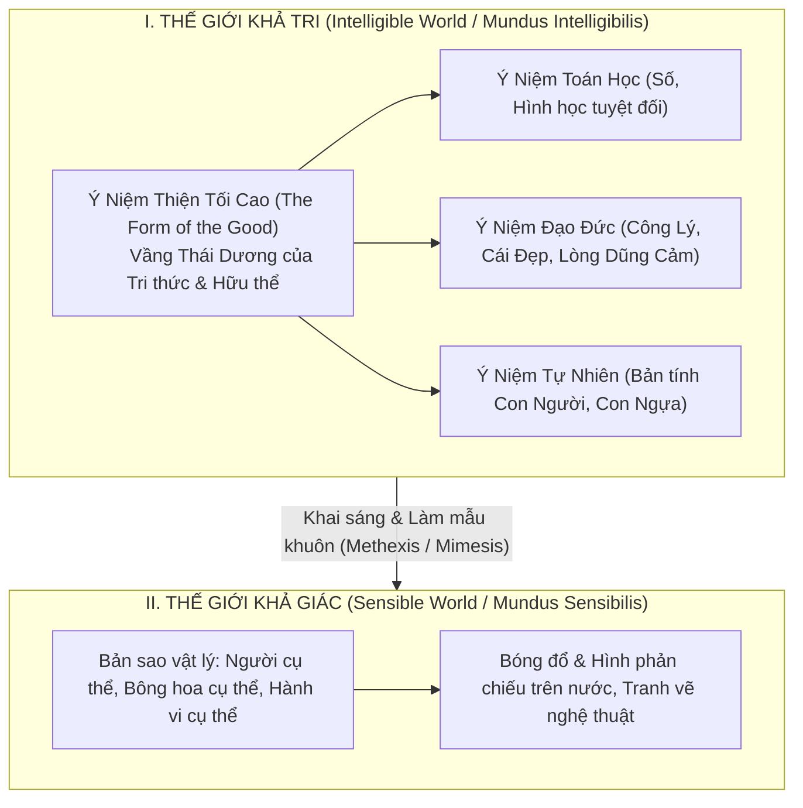

# CHUYÊN KHẢO HÀN LÂM 04: BẢN THỂ LUẬN NHỊ NGUYÊN CỦA PLATO, THUYẾT Ý NIỆM (FORMS) VÀ ẨN DỤ HANG ĐỘNG

> **Mã chuyên đề:** PHIL-104-PLATO  
> **Cấp độ:** Cử nhân / Khảo cứu Kinh điển Nền tảng (Classical Foundation)  
> **Phạm vi học thuật:** Thế kỷ IV TCN tại Viện Hàn Lâm Athens (*Akadēmeia*)  
> **Văn bản nguồn quy chuẩn (Stephanus Pagination):**  
> - *Republic* (Cộng Hòa), Quyển V, VI, VII (Stephanus 473c – 541b)  
> - *Phaedo* (Phê-đông - Về sự bất tử của linh hồn) (Stephanus 64a – 84b)  
> - *Parmenides* (Phê phán Thuyết Ý niệm sơ kỳ) (Stephanus 127d – 135c)  
> - *Timaeus* (Vũ trụ luận và Đấng Kiến Tạo Demiourgos) (Stephanus 27c – 34a)  
> **Thuật ngữ Hy Lạp bản thể luận:**  
> - $\epsilon\tilde{i}\delta o\varsigma$ (*Eidos*) / $\iota\delta\epsilon'\alpha$ (*Idea*): Ý niệm, Mẫu hình hoàn hảo siêu nghiệm, Bản chất tự thân.  
> - $\mu\epsilon'\theta\epsilon\xi\iota\varsigma$ (*Methexis*): Sự tham dự của đồ vật giác quan vào Ý niệm.  
> - $\mu\iota'\mu\eta\sigma\iota\varsigma$ (*Mimesis*): Sự mô phỏng, sao chép không hoàn hảo.  
> - $\nu o'\eta\sigma\iota\varsigma$ (*Noesis*): Trực giác trí tuệ thuần túy nắm bắt chân lý.  
> - $\delta o'\xi\alpha$ (*Doxa*): Dư luận, ý kiến cảm tính, niềm tin thiếu cơ sở logic.  
> - $\alpha\nu\alpha'\mu\nu\eta\sigma\iota\varsigma$ (*Anamnesis*): Thuyết Hồi tưởng - nhận thức là quá trình linh hồn nhớ lại tri thức đã quên.

---

## 1. BỐI CẢNH TRI THỨC LUẬN: CUỘC HÒA GIẢI GIỮA HERACLITUS VÀ PARMENIDES

### 1.1. Khủng hoảng Chủ nghĩa Tương đối của Nhóm Ngụy Biện (The Sophist Crisis)
Vào thế kỷ V TCN tại Athens, phong trào Ngụy biện (*Sophism*) trỗi dậy với các đại diện tiêu biểu như Protagoras (*"Con người là thước đo của vạn vật"*) và Gorgias (*"Không có gì tồn tại; nếu có tồn tại cũng không thể biết; nếu biết cũng không thể truyền đạt cho người khác"*). Chủ nghĩa tương đối này đã:
- Phá hủy nền tảng của Chân lý khách quan: Cái gì tôi thấy đúng thì đúng với tôi; cái gì anh thấy đúng thì đúng với anh.
- Làm suy đồi đạo đức và chính trị: Công lý bị quy giản thành *ý chí của kẻ mạnh* (như luận điểm của Thrasymachus trong *Cộng hòa* Quyển I). Cái chết oan khốc của Socrates (399 TCN) dưới bàn tay của nền dân chủ mị dân Athens là động lực đau đớn thôi thúc Plato phải tìm kiếm một **Nền tảng Chân lý Tuyệt đối Bất biến** vượt lên trên sự đổi thay của đời sống chính trị.

### 1.2. Chiến lược Triết học của Plato
Plato đối diện với hai di sản đối lập của tiền nhân:
1. **Heraclitus đúng:** Toàn bộ thế giới vật chất khả giác xung quanh ta đều không ngừng biến đổi (*Panta Rhei*); do đó, thông qua giác quan, con người **không bao giờ có thể đạt được Tri thức chân thực (Episteme)**, mà chỉ có thể thu được Dư luận cảm tính bấp bênh (*Doxa*).
2. **Parmenides đúng:** Tri thức chân chính đòi hỏi đối tượng của nó phải là vĩnh hằng, bất biến và hoàn hảo.
- **Giải pháp nhị nguyên của Plato:** *Tách thực tại làm hai thế giới*: Thế giới Khả giác (bản sao biến đổi) và Thế giới Khả tri của các Ý niệm (nguyên bản bất biến).

---

## 2. BẢN THỂ LUẬN VỀ CÁC Ý NIỆM (THE THEORY OF FORMS)



### 2.1. Bản chất của một "Ý niệm" (Eidos / Form)
Một Ý niệm theo nghĩa của Plato **không phải là một ý nghĩ chủ quan nằm trong đầu con người**, mà là một **Thực tại khách quan độc lập, phi không gian, phi thời gian, bất biến và hoàn hảo tuyệt đối**.
- *Ví dụ về Hình Tam Giác:* Không có bất kỳ hình tam giác nào vẽ trên cát, vẽ trên giấy, hay chế tạo bằng kim loại là một hình tam giác hoàn hảo tuyệt đối (các cạnh của nó luôn có độ dày vật lý, góc luôn có sai số vi mô, và nó sẽ bị thời gian xóa nhòa). Nhưng tâm trí chúng ta vẫn sở hữu ý niệm về một "Hình Tam Giác Hoàn Hảo" (tổng 3 góc chính xác bằng 180 độ). Hình tam giác hoàn hảo đó chính là **Form (Ý niệm)**.
- Mọi hình tam giác vật lý cụ thể trong cõi trần chỉ là những **Bản sao không hoàn hảo (Mimesis)** tham dự (*Methexis*) vào Ý niệm Tam giác duy nhất đó.

### 2.2. Lập Luận Tri Thức Luận Về "Cái Một Trên Cái Nhiều" (One Over Many)
1. Giả sử ta có 100 con ngựa với màu sắc, kích thước, độ tuổi khác nhau (con đen, con trắng, con què, con khỏe).
2. Tại sao ta đều nhận diện được cả 100 con vật khác biệt đó cùng là "Con Ngựa" mà không nhầm với con bò?
3. Phải có một đặc tính cốt lõi chung duy nhất làm cho một con ngựa là con ngựa: Đó chính là **Ý niệm Ngựa (Equinity / Form of Horse)**.
4. Cái Một (Ý niệm) giải thích và đem lại ý nghĩa tồn tại cho Cái Nhiều (các cá thể cụ thể).

---

## 3. BA ẨN DỤ KINH ĐIỂN TRONG "CỘNG HÒA" (QUYỂN VI & VII)

Plato dùng 3 ẩn dụ liên hoàn để soi sáng toàn bộ hệ thống Bản thể luận, Nhận thức luận và Triết học chính trị của mình:

### 3.1. Ẩn dụ Mặt Trời (The Analogy of the Sun) - Stephanus 507b–509c
- Trong thế giới khả giác: Mặt trời chiếu rọi ánh sáng giúp mắt ta nhìn thấy đồ vật, đồng thời cung cấp năng lượng và sự sống cho muôn loài sinh sôi nảy nở.
- Trong thế giới khả tri: **Ý Niệm Thiện (The Form of the Good)** đóng vai trò y hệt như Mặt Trời:
  1. Nó chiếu rọi Chân lý giúp Lý trí con người hiểu được bản chất các Ý niệm khác.
  2. Nó là nguồn cội ban phát **Hữu thể và Sự tồn tại (Being and Reality)** cho toàn bộ thế giới ý niệm. Ý niệm Thiện vượt lên trên cả Hữu thể về phẩm giá và quyền năng.

---

### 3.2. Ẩn dụ Đường Dây Chia Cắt (The Divided Line) - Stephanus 509d–511e
Plato yêu cầu ta tưởng tượng một đoạn thẳng bị cắt làm hai phần không bằng nhau, sau đó mỗi phần lại bị cắt tiếp theo cùng tỷ lệ:

$$\begin{array}{|c|c|c|c|}
\hline
\textbf{Cấp độ Thực tại (Ontology)} & \textbf{Cấp độ Nhận thức (Epistemology)} & \textbf{Trạng thái Tâm trí} & \textbf{Đối tượng} \\
\hline
\text{I. KHẢ TRI (Intelligible)} & \textbf{EPISTEME (Tri thức chân thực)} & \text{Noesis (Trực giác lý trí)} & \text{Các Ý niệm thuần túy & Ý niệm Thiện} \\
\cline{3-4}
\text{(Thực tại tối cao)} & & \text{Dianoia (Tư duy suy diễn)} & \text{Toán học, Hình học trừu tượng} \\
\hline
\text{II. KHẢ GIÁC (Visible)} & \textbf{DOXA (Ý kiến cảm tính)} & \text{Pistis (Niềm tin thực nghiệm)} & \text{Sinh vật, đồ vật nhân tạo cụ thể} \\
\cline{3-4}
\text{(Bóng ảo biến dịch)} & & \text{Eikasia (Ảo tưởng / Phỏng đoán)} & \text{Bóng đổ, hình phản chiếu, nghệ thuật} \\
\hline
\end{array}$$

- **Bước chuyển từ Dianoia lên Noesis:** Các nhà toán học vẫn phải dựa vào các hình vẽ minh họa và các tiên đề chưa chứng minh được (giả thiết). Nhà biện chứng triết học vượt qua các giả thiết đó, dùng lý tính thuần túy leo lên đến **Nguyên lý Đệ nhất không cần giả thiết (The Unhypothetical First Principle - Ý niệm Thiện)**.

---

### 3.3. Ẩn Dụ Hang Động (The Allegory of the Cave) - Stephanus 514a–520a

```
    [Ánh sáng Mặt Trời tự nhiên] -> Bên ngoài hang: Vạn vật thật, Bầu trời thật
                ^
           (Lối trèo dốc đứng)
                |
    [Đống Lửa nhân tạo] -> Những người mang hình nhân đi qua đi lại
                |
          (Bức vách ngăn)
                v
    [Những Người Tù Bị Xích] -> Nhìn vào vách đá: Chỉ thấy BÓNG ẢO (Eikasia)
```

#### A. Tình cảnh bản thể của nhân loại (The Human Condition)
- Nhân loại bình thường giống như những người tù bị xiềng xích từ nhỏ dưới đáy hang tối tăm. Cổ bị khóa chặt, chỉ nhìn thấy một vách đá trước mặt.
- Phía sau họ, một đống lửa cháy rực; giữa đống lửa và người tù có một bức tường, người ta mang các bức tượng, hình nhân đi qua lại. Chiếc bóng đổ lên vách đá và tiếng vang dội lại chính là toàn bộ "thực tại" duy nhất mà người tù biết đến.
- Nếu những người tù tổ chức thi thố xem ai đoán trúng chiếc bóng nào xuất hiện trước để trao giải thưởng, họ đang tôn vinh sự vô minh tột đỉnh của thế giới trần tục.

#### B. Nỗi đau đớn của Cuộc Giải Phóng Tri Thức (The Ascend)
- Một người tù được bẻ gãy xiềng xích, bị ép đứng dậy và quay đầu lại nhìn đống lửa: Ánh sáng làm mắt anh đau nhức dữ dội; anh thấy những hình nhân bằng gỗ và nhận ra chiếc bóng trước đây chỉ là ảo giác.
- Người đó bị kéo lê cưỡng bức trèo qua con dốc gồ ghề ra ngoài miệng hang: Dưới ánh nắng Mặt Trời chói chang, anh ta ban đầu hoàn toàn mù lòa vì quá sáng.
- **Tiến trình thích nghi:** Ban đầu anh chỉ nhìn được bóng phản chiếu dưới nước vào ban đêm; sau đó nhìn được sao trời và trăng; cuối cùng, anh đủ sức **nhìn thẳng vào vầng Thái Dương** và nhận ra rằng Mặt Trời chính là nguồn cội sinh ra các mùa, năm tháng và điều khiển vạn vật.

#### C. Bi kịch Trở Lại Hang Động và Cái Chết Của Socrates
- Tràn ngập lòng trắc ẩn, người được giải phóng quay lại đáy hang để giải cứu các bạn tù.
- Khi mắt vừa từ ánh sáng bước vào bóng tối, anh vấp ngã loạng choạng. Những người tù bên dưới cười nhạo anh, cho rằng chuyến đi lên trên đã làm hỏng mắt anh.
- Khi anh cố gắng tháo xích và thuyết phục họ bước ra ngoài ánh sáng, họ cho rằng anh là kẻ điên loạn phá hoại trật tự, và **nếu có thể bắt được anh, họ sẽ giết chết anh** (Đây là lời tố cáo trực tiếp của Plato đối với bản án tử hình mà tòa án Athens dành cho Socrates).

---

## 4. PHẢN BIỆN NỘI TẠI KINH ĐIỂN: ĐỐI BÁC "CON NGƯỜI THỨ BA" (THE THIRD MAN ARGUMENT)

Chính Plato trong tác phẩm hậu kỳ đối thoại *Parmenides* (132a-b) đã dũng cảm đưa ra phản biện sắc bén làm lung lay tận gốc Thuyết Ý niệm của chính mình:

```
[Cá nhân Người a, b, c] ---> Cần [Ý Niệm Người 1] để giải thích điểm chung
          \                           /
           \                         /
            v                       v
       Cần [Ý Niệm Con Người Thứ Ba - Form 2] để giải thích điểm chung giữa (a,b,c) và Form 1!
                               |
                               v
                     ... Thoái lui vô hạn (Ad Infinitum) ...
```

1. **Tiền đề Khái quát hóa (One Over Many):** Khi một tập hợp các đối tượng $a, b, c$ cùng có thuộc tính $F$, phải tồn tại một Ý niệm $F_1$ mà chúng tham dự vào.
2. **Tiền đề Tự Khẳng Định Thuộc Tính (Self-Predication):** Bản thân Ý niệm $F_1$ cũng chính là một thực thể sở hữu thuộc tính $F$ một cách hoàn hảo nhất (Ví dụ: Ý niệm Đẹp tự thân nó là Đẹp nhất; Ý niệm Con Người tự thân nó cũng là một Con Người).
3. **Tiền đề Bất Khả Tự Thân Tham Dự (Non-Identity):** Không có sự vật nào có thể tham dự vào chính bản thân nó; do đó, Ý niệm $F_1$ không thể đồng nhất với tập hợp các cá thể $a, b, c$.
4. **Hệ quả Tất yếu:** Tập hợp mới gồm $\{a, b, c, F_1\}$ là một tập hợp các đối tượng cùng sở hữu thuộc tính $F$. Do đó, theo Tiền đề 1, bắt buộc phải tồn tại một Ý niệm mới cao hơn là $F_2$ (Con Người Thứ Ba).
5. Quá trình này lặp lại liên tục dẫn đến một chuỗi **Thoái lui vô hạn (Infinite Regress)**, phá hủy tính duy nhất và năng lực giải thích của Thuyết Ý niệm.

---

## 5. Ý NGHĨA CHÍNH TRỊ HỌC: HÌNH MẪU "VUA TRIẾT GIA" (THE PHILOSOPHER KING)

Từ Bản thể luận và Nhận thức luận, Plato rút ra kết luận chính trị chấn động trong *Cộng Hòa* (473d):
> *"Chừng nào các triết gia chưa trở thành vua chúa trong các quốc gia, hoặc các vua chúa chưa có tinh thần và năng lực triết học thực sự... chừng đó các quốc gia và toàn thể nhân loại sẽ không bao giờ thoát khỏi tai ương đau khổ."*

- **Lập luận tính chuyên môn:** Khi bạn ốm, bạn tìm bác sĩ hay tổ chức bỏ phiếu lấy ý kiến đám đông? Khi một con tàu gặp bão biển, bạn trao tay lái cho hoa tiêu am hiểu thiên văn hải trình hay trao cho đám thủy thủ say xỉn đang tranh giành bánh lái?
- Nền chính trị dân chủ mị dân trao quyền lực cho những kẻ dẻo miệng lấy lòng đám đông (như đám thủy thủ say rượu). Chỉ có **Triết gia** - người đã bước ra khỏi hang động, chiêm ngưỡng được Ý Niệm Thiện và Công Lý Khách Quan - mới là người duy nhất nắm giữ chiếc la bàn đạo đức để dẫn dắt con thuyền quốc gia cập bến công bằng và hạnh phúc.

---

## 6. HƯỚNG DẪN HỘI THẢO CHUYÊN KHẢO & ĐỀ TÀI TIẾN SĨ (PHD RESEARCH PROMPTS)

1. **Plato và Thuyết Ma Trận Hiện Đại (The Matrix Hypothesis):** Phân tích Ẩn dụ Hang động dưới lăng kính của Thuyết Giả Lập Số (Simulation Hypothesis) của Nick Bostrom và Thuyết Hoài nghi Nhận thức Luận của Descartes: Làm thế nào ta chứng minh được ta không phải là một "Não trong thùng" (Brain in a Vat) đang xem các dòng mã thuật toán?
2. **Giải quyết Nghịch lý "Con Người Thứ Ba":** Khảo sát các giải pháp đương đại của Gregory Vlastos, Colin Strang và Gail Fine về việc loại bỏ Tiền đề Tự Khẳng Định Thuộc Tính (*Self-Predication*) để cứu vãn Thuyết Ý niệm của Plato.
3. **Ý niệm Toán học trong Vật lý Hiện đại:** Tại sao các phương trình toán học trừu tượng thuần túy (như Hình học phi Euclid của Riemann, Ma trận của Heisenberg) lại mô tả chính xác tuyệt đối cấu trúc vũ trụ vật lý? Liệu có phải các nhà vật lý lượng tử hiện đại đang vô thức trở thành những người Platonist?

---

## 7. TÀI LIỆU KHẢO CỨU NGUYÊN TÁC & THỨ CẤP QUY CHUẨN

- Plato (1997), *Complete Works*, ed. John M. Cooper, Indianapolis: Hackett Publishing.
- Vlastos, G. (1954), "The Third Man Argument in the *Parmenides*", *The Philosophical Review*, 63(3), 319–349.
- Annas, J. (1981), *An Introduction to Plato's Republic*, Oxford: Clarendon Press.
- Fine, G. (1993), *On Ideas: Aristotle's Criticism of Plato's Theory of Forms*, Oxford University Press.
- Heidegger, M. (1942/1998), *Platons Lehre von der Wahrheit* (Học thuyết của Plato về Chân lý).
- SEP (Stanford Encyclopedia of Philosophy): "Plato's Middle Period Metaphysics and Epistemology".
