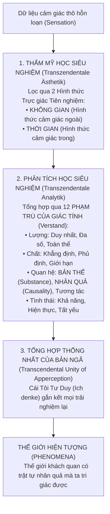

# CHUYÊN KHẢO HÀN LÂM 13: CUỘC CÁCH MẠNG TRI THỨC LUẬN CỦA IMMANUEL KANT: PHÁN ĐOÁN TỔNG HỢP TIÊN NGHIỆM VÀ PHÂN BIỆN HIỆN TƯỢNG - VẬT TỰ THÂN

> **Mã chuyên đề:** PHIL-203-KANT  
> **Cấp độ:** Cử nhân Chuyên sâu / Sau đại học (Advanced Undergraduate / Graduate Core)  
> **Phạm vi học thuật:** Thế kỷ XVIII (Thời kỳ Khai sáng Đức - *Aufklärung* tại Königsberg)  
> **Văn bản nguồn quy chuẩn (Akademie-Ausgabe - AA):**  
> - *Kritik der reinen Vernunft* (Phê Phán Lý Tính Thuần Túy) - Ấn bản A (1781) & Ấn bản B (1787) (AA III & IV)  
> - *Prolegomena zu einer jeden künftigen Metaphysik* (1783) (AA IV)  
> - *Grundlegung zur Metaphysik der Sitten* (1785) (AA IV)  
> **Thuật ngữ triết học Đức cốt lõi:**  
> - *Synthetisch a priori*: Phán đoán tổng hợp tiên nghiệm (mở rộng tri thức nhưng tất yếu phổ quát).  
> - *Das Ding an sich*: Vật tự thân (thực tại độc lập khi không bị con người quan sát).  
> - *Erscheinung* / *Phänomenon*: Hiện tượng (thực tại được cấu trúc hóa qua lăng kính nhận thức con người).  
> - *Transzendentale Ästhetik*: Thẩm mỹ học siêu nghiệm (nghiên cứu Không gian & Thời gian như hình thức trực giác cảm tính tiên nghiệm).  
> - *Kategorien des Verstandes*: 12 Phạm trù của Giác tính (Lượng, Chất, Quan hệ, Khả năng).  
> - *Kopernikanische Wende*: Cuộc đảo ngược Kopernik trong triết học.

---

## 1. KHỦNG HOẢNG KÉP CỦA TRIẾT HỌC CẬN ĐẠI: GIẤC NGỦ GIÁO ĐIỀU VÀ VỰC THẲM HOÀI NGHI

### 1.1. Sự Bế Tắc Giữa Hai Chiến Tuyến Tri Thức Luận
Vào giữa thế kỷ XVIII, triết học phương Tây rơi vào một cuộc nội chiến tri thức luận không có lối thoát:
1. **Chủ nghĩa Duy lý Giáo điều (Continental Rationalism - Leibniz, Wolff):**
   - Khẳng định: Lý tính thuần túy có thể dùng các nguyên lý bẩm sinh suy diễn ra toàn bộ thực tại tối hậu (sự tồn tại của Thượng đế, sự bất tử của linh hồn, khởi nguyên vũ trụ) mà không cần đến kinh nghiệm.
   - Hậu quả: Xây dựng nên những tòa lâu đài siêu hình học lộng lẫy trên cát, hoàn toàn thiếu khả năng kiểm chứng thực tế và dẫn đến những tranh cãi giáo điều vô tận.
2. **Chủ nghĩa Duy nghiệm Hoài nghi (British Empiricism - David Hume):**
   - Hume đã giáng một đòn sấm sét vào nền móng khoa học khi chứng minh: Nguyên lý nhân quả không phải là quy luật khách quan của vũ trụ, mà chỉ là *thói quen tâm lý liên tưởng* sau nhiều lần quan sát.
   - Hậu quả: Nếu nhân quả chỉ là thói quen tâm lý, thì toàn bộ các định luật vật lý tất định vĩ đại của Isaac Newton bỗng chốc trở thành những phỏng đoán xác suất mong manh!

### 1.2. Kant Bị Đánh Thức Khỏi "Giấc Ngủ Giáo Điều"
Trong cuốn *Prolegomena* (1783), Kant đã viết câu nói nổi tiếng bậc nhất:
> *"Tôi công khai thừa nhận: Lời gợi ý của David Hume chính là điều đầu tiên, từ nhiều năm trước, đã cắt đứt giấc ngủ giáo điều của tôi và đem lại cho các nghiên cứu của tôi trong lĩnh vực triết học tư biện một hướng đi hoàn toàn mới."*

Nhiệm vụ lịch sử vĩ đại của Kant trong bộ *Kritik der reinen Vernunft* (1781) là: **Thực hiện một phiên tòa phê phán chính năng lực của Lý tính** (*Critique of Pure Reason*): Thiết lập ranh giới hợp pháp của những gì lý tính con người *có thể biết*, đồng thời cứu vãn tính tất yếu phổ quát của Khoa học thực nghiệm khỏi sự sụp đổ của chủ nghĩa hoài nghi Hume.

---

## 2. PHÂN LOẠI PHÁN ĐOÁN: BẢN GIAO HƯỞNG "SYNTHETISCH A PRIORI"

Trước Kant, người ta tin rằng mọi phán đoán chỉ chia làm 2 loại duy nhất (tương ứng với Chiếc Dao Cạo Hume):

$$\begin{array}{|c|c|c|}
\hline
& \textbf{Tiên nghiệm (A priori - Độc lập với kinh nghiệm)} & \textbf{Hậu nghiệm (A posteriori - Phụ thuộc kinh nghiệm)} \\
\hline
\textbf{Phán đoán Phân tích} & \text{Phân tích Tiên nghiệm (Mọi người độc thân chưa cưới vợ)} & \text{KHÔNG TỒN TẠI} \\
\text{(Thuộc từ nằm sẵn trong Chủ từ)} & \rightarrow \text{Chắc chắn tuyệt đối nhưng KHÔNG MỞ RỘNG tri thức mới} & \text{(Mâu thuẫn logic nội tại)} \\
\hline
\textbf{Phán đoán Tổng hợp} & \textbf{PHÁT KIẾN VĨ ĐẠI CỦA KANT:} & \text{Tổng hợp Hậu nghiệm (Quả táo này ngọt)} \\
\text{(Thuộc từ bổ sung cái mới)} & \textbf{PHÁN ĐOÁN TỔNG HỢP TIÊN NGHIỆM} & \rightarrow \text{Mở rộng tri thức mới nhưng NGẪU NHIÊN,} \\
& \rightarrow \text{Vừa mở rộng tri thức VỪA TẤT YẾU PHỔ QUÁT!} & \text{không có tính phổ quát chắc chắn} \\
\hline
\end{array}$$

### 2.1. Bản chất của Phán Đoán Tổng Hợp Tiên Nghiệm (Synthetic A Priori Judgments)
Câu hỏi trung tâm của toàn bộ cuốn sách: **"Làm thế nào các phán đoán tổng hợp tiên nghiệm khả thi?"** (*Wie sind synthetische Urteile a priori möglich?*).
- **Trong Toán học:** Mệnh đề $7 + 5 = 12$.
  - Khái niệm "$7 + 5$" chỉ chứa đựng ý niệm về sự gộp hai số lại, **hoàn toàn không chứa sẵn khái niệm về số $12$**. Ta phải thực hiện một thao tác trực giác tổng hợp (đếm ngón tay hoặc đếm điểm thời gian) để vươn tới số $12$. Đây là phán đoán *Tổng hợp* (Synthetic).
  - Nhưng kết quả $12$ là đúng tất yếu ở mọi thời điểm, trong mọi vũ trụ, không cần đi khảo sát hàng triệu phép thử ngoài đời. Đây là phán đoán *Tiên nghiệm* (A priori).
- **Trong Vật lý học Tự nhiên:** Định luật *"Mọi biến đổi đều phải có một nguyên nhân"* hoặc *"Trong mọi sự tương tác vật chất, tổng năng lượng luôn được bảo toàn"*. Đây là các phán đoán tổng hợp tiên nghiệm làm nền tảng cho khoa học tự nhiên.

---

## 3. CUỘC CÁCH MẠNG KOPERNIK TRONG TRIẾT HỌC

```
MÔ HÌNH TRUYỀN THỐNG (Cổ điển):
[Đồ vật bên ngoài] ---------- (áp đặt thuộc tính) ----------> [Tâm trí con người thụ động]

CUỘC ĐẢO NGƯỢC KOPERNIK CỦA KANT:
[Dữ liệu giác quan thô] ---> [KHUNG LẬP TRÌNH TIÊN NGHIỆM CỦA TÂM TRÍ] ---> [Thế giới Hiện tượng (Phenomena)]
                             - Không gian & Thời gian (Trực giác)
                             - 12 Phạm trù Giác tính (Nhân quả, Bản thể...)
```

### 3.1. Lời Tuyên Bố Lịch Sử
Kopernik đã làm nên cuộc cách mạng thiên văn học khi nhận thấy việc giả định bầu trời quay quanh người quan sát đứng yên dẫn đến những phép tính quá phức tạp; ông đã thử đổi ngược lại: Cho người quan sát quay và các vì sao đứng yên. Kant làm điều tương tự trong triết học:
> *"Từ trước đến nay người ta cho rằng mọi nhận thức của chúng ta phải tuân theo các đồ vật... Giờ đây, chúng ta hãy thử giả định ngược lại rằng: Các đồ vật buộc phải tuân theo cấu trúc nhận thức của chính chúng ta!"* (Lời tựa ấn bản B, B xvi).

---

## 4. CẤU TRÚC BỘ MÁY NHẬN THỨC THEO KANT

Nhận thức của con người không phải là một chiếc hộp đen rỗng, mà hoạt động như một hệ thống xử lý thông tin gồm 3 tầng tích hợp chặt chẽ:



### 4.1. Thẩm Mỹ Học Siêu Nghiệm: Không Gian và Thời Gian
Kant đưa ra luận điểm gây kinh ngạc: **Không gian và Thời gian không phải là những thực thể vật lý tồn tại ngoài kia độc lập với con người (như Newton nghĩ), cũng không phải là các mối quan hệ trừu tượng giữa các đồ vật (như Leibniz nghĩ)**.
- Không gian và Thời gian là **Hai Hình thức Trực giác Cảm tính Tiên nghiệm (A priori forms of sensible intuition)** của chính tâm trí con người.
- Chúng giống như một *cặp kính màu xanh* gắn chặt vào mắt ta từ lúc sinh ra. Ta nhìn thấy vạn vật có kích thước không gian và diễn tiến theo thời gian không phải vì bản thân sự vật tự nó như vậy, mà vì **đó là cách duy nhất mà bộ máy giác quan con người có thể tiếp nhận dữ liệu**.

### 4.2. Giác Tính và Câu Nói Bất Hủ
Sau khi dữ liệu được đóng khung vào Không gian và Thời gian, nó được các **Phạm trù Giác tính (Categories)** nhào nặn thành các khái niệm. Kant đúc kết mối quan hệ hữu cơ:
> *"Gedanken ohne Inhalt sind leer, Anschauungen ohne Begriffe sind blind."*  
> **(Tư tưởng mà không có nội dung trực giác thì rỗng tuếch; Trực giác mà không có khái niệm thì mù quáng - B 75).**

---

## 5. RANH GIỚI BẤT KHẢ VƯỢT QUA: PHENOMENA VS DING AN SICH

Đây là điểm cốt tử của Chủ nghĩa Duy tâm Siêu nghiệm (*Transcendental Idealism*):

| Đặc điểm | PHENOMENA (Hiện Tượng Giới) | DING AN SICH (Vật Tự Thân / Noumena) |
| :--- | :--- | :--- |
| **Bản chất** | Sự vật xuất hiện trước nhận thức con người | Sự vật như chính nó độc lập với nhận thức |
| **Cấu trúc** | Bị chi phối bởi Không gian, Thời gian & 12 Phạm trù | Phi không gian, phi thời gian, phi phạm trù nhân quả |
| **Khả năng nhận thức** | **Hoàn toàn nhận thức được một cách khách quan khoa học** | **Vĩnh viễn bất khả tri (Inaccessible to theoretical reason)** |
| **Vai trò** | Địa hạt của Khoa học tự nhiên (Toán, Lý) | Ranh giới giới hạn sự kiêu ngạo của lý tính |

- **Ý nghĩa giải phóng:** Bằng việc giới hạn nhận thức con người trong địa hạt Hiện tượng, Kant đã bảo vệ trọn vẹn khoa học thực nghiệm của Newton. Đồng thời, bằng việc chứng minh rằng Vật tự thân nằm ngoài quy luật nhân quả vật lý cơ học tất định, Kant đã mở ra không gian cho **Tự do Ý chí, Đạo đức học và Niềm tin tôn giáo**:
  > *"Ich musste also das Wissen aufheben, um zum Glauben Platz zu bekommen."*  
  > **(Tôi phải dẹp tri thức qua một bên, để nhường chỗ cho Niềm Tin - Lời tựa ấn bản B, B xxx).**

---

## 6. SỰ SỤP ĐỔ CỦA SIÊU HÌNH HỌC TRUYỀN THỐNG: CÁC NGHỊCH LÝ (ANTINOMIES)

Trong phần *Biện chứng học siêu nghiệm (Transcendental Dialectic)*, Kant chứng minh rằng bất cứ khi nào Lý tính con người vượt qua ranh giới kinh nghiệm để suy đoán về Vũ trụ tổng thể, nó đều rơi vào **4 Nghịch lý không thể giải quyết (Antinomies)**, nơi cả hai mệnh đề trái ngược nhau đều có thể được chứng minh bằng logic chặt chẽ:

$$\begin{array}{|l|l|}
\hline
\textbf{Chính Đề (Thesis - Quan điểm Duy lý)} & \textbf{Phản Đề (Antithesis - Quan điểm Duy nghiệm)} \\
\hline
\text{1. Thế giới có khởi đầu trong thời gian & bị giới hạn trong không gian.} & \text{Thế giới vô tận, không có khởi đầu thời gian & không gian.} \\
\hline
\text{2. Mọi thực thể phức hợp đều cấu tạo từ các phần tử đơn giản (Nguyên tử).} & \text{Không có gì là đơn giản; mọi thứ đều có thể phân chia vô hạn.} \\
\hline
\text{3. Ngoài luật nhân quả tự nhiên, còn có nguyên nhân do TỰ DO.} & \text{Không có Tự do; mọi thứ diễn ra theo luật nhân quả cơ học.} \\
\hline
\text{4. Có một Đấng Tối Cao tất yếu (Thượng đế) là nguyên nhân thế giới.} & \text{Không có Đấng Tối Cao nào; mọi sự tồn tại đều là ngẫu nhiên.} \\
\hline
\end{array}$$

- **Kết luận của Kant:** Siêu hình học tư biện truyền thống là một sự ảo tưởng nhận thức (*Transcendental Illusion*). Chúng ta không thể chứng minh Thượng đế tồn tại bằng toán học hay vật lý; Thượng đế và Tự do chỉ có thể được thừa nhận như một **Tiên đề thực hành của Đạo đức học (Postulates of Practical Reason)**.

---

## 7. HƯỚNG DẪN HỘI THẢO & ĐỀ TÀI NGHIÊN CỨU TIẾN SĨ (PHD RESEARCH PROMPTS)

1. **Kant và Thuyết Nhận Thức Luận Tiến Hóa (Evolutionary Epistemology):** Khảo sát luận điểm của Konrad Lorenz: Liệu Không gian, Thời gian và các Phạm trù của Kant có phải là những cấu trúc giải phẫu thần kinh tiên nghiệm đối với cá nhân, nhưng lại là sản phẩm hậu nghiệm được tôi luyện qua hàng triệu năm tiến hóa sinh học của giống loài?
2. **Khoa Học Nhận Thức và Khung Xử Lý Dự Đoán (Predictive Processing):** So sánh mô hình nhận thức "từ trên xuống" (Top-down cognitive processing) của khoa học não bộ hiện đại (Karl Friston, Andy Clark) với Cuộc cách mạng Kopernik của Kant: Não bộ như một cỗ máy tạo mô hình suy diễn giả thuyết.
3. **Phản biện của Thuyết Hiện Thực Tư Biện (Speculative Realism):** Phân tích sự phê phán của Quentin Meillassoux (*After Finitude*) đối với "Thuyết Tương Quan Luận" (Correlationism) của Kant: Làm sao con người có thể nói về "Thời kỳ Tiền sinh học" (The Ancestral Realm - Trái đất trước khi có sự sống và ý thức con người) nếu thực tại luôn bị lệ thuộc vào sự tương quan với ý thức?

---

## 8. TÀI LIỆU KHẢO CỨU NGUYÊN TÁC & THỨ CẤP QUY CHUẨN

- Kant, I. (1998), *Critique of Pure Reason*, trans. Paul Guyer & Allen W. Wood, Cambridge: Cambridge University Press.
- Allison, H. E. (2004), *Kant's Transcendental Idealism: An Interpretation and Defense* (2nd ed.), New Haven: Yale University Press.
- Strawson, P. F. (1966), *The Bounds of Sense: An Essay on Kant's Critique of Pure Reason*, London: Methuen.
- Guyer, P. (ed.) (1992), *The Cambridge Companion to Kant*, Cambridge University Press.
- Heidegger, M. (1929/1997), *Kant und das Problem der Metaphysik*, Frankfurt am Main: Klostermann.
- SEP: "Kant's Critique of Metaphysics" & "Kant's Transcendental Idealism".
