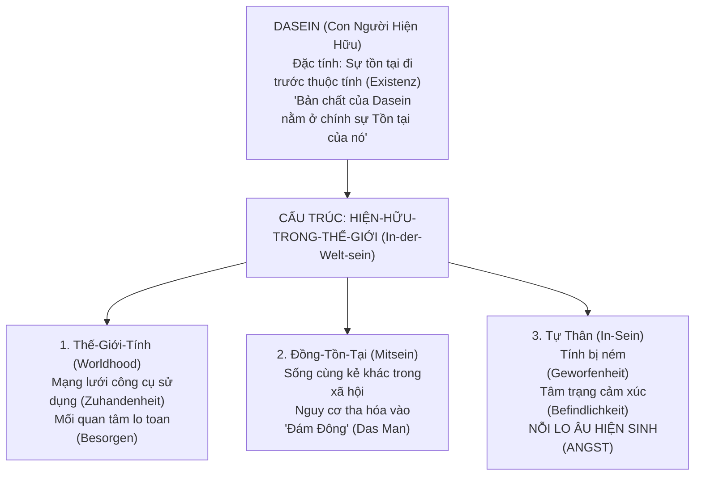

# CHUYÊN KHẢO HÀN LÂM 25: MARTIN HEIDEGGER: HỮU THỂ VÀ THỜI GIAN (SEIN UND ZEIT) - BẢN THỂ LUẬN CƠ BẢN, DASEIN, NỖI LO ÂU VÀ TỒN TẠI HƯỚNG VỀ CÁI CHẾT

> **Mã chuyên đề:** PHIL-303-HEIDEGGER  
> **Cấp độ:** Thạc sĩ Chuyên ngành / Nghiên cứu sinh (Graduate Seminar Core)  
> **Phạm vi học thuật:** Thế kỷ XX (Trường phái Hiện tượng học Đức tại Freiburg & Marburg)  
> **Văn bản nguồn quy chuẩn (Gesamtausgabe - GA):**  
> - *Sein und Zeit* (1927) (GA Band 2)  
> - *Kant und das Problem der Metaphysik* (1929) (GA Band 3)  
> - *Was ist Metaphysik?* (1929) (GA Band 9)  
> - *Brief über den Humanismus* (1947) (GA Band 9)  
> **Hệ thống thuật ngữ Hiện tượng học Heidegger (Heideggerian Lexicon):**  
> - *Die Seinsfrage*: Câu hỏi về ý nghĩa của Hữu Thể.  
> - *Dasein*: Hiện-Hữu (con người với tư cách là 'nơi chốn' mà tại đó Hữu thể tự hé lộ).  
> - *In-der-Welt-sein*: Hiện-Hữu-Trong-Thế-Giới (cấu trúc bất khả phân tách giữa con người và thế giới).  
> - *Zuhandenheit*: Đồ dùng sẵn tay (thế giới như một mạng lưới công cụ thực hành).  
> - *Vorhandenheit*: Đồ vật hiện diện trước mắt (thế giới như các vật thể lý thuyết trơ trọi).  
> - *Das Man*: "Người Ta" / Đám đông vô danh (phương thức sống tha hóa, không đích thực).  
> - *Geworfenheit*: Tính bị ném (tình trạng Dasein bị ném vào một hoàn cảnh lịch sử không chọn lựa).  
> - *Angst*: Nỗi lo âu hiện sinh (đối diện với tính Hư vô của thế giới).  
> - *Sein-zum-Tode*: Tồn tại hướng về cái chết (khả năng tối hậu định hình tính đích thực).  
> - *Sorge*: Sự ân cần lo toan (cấu trúc bản thể tổng thể của Dasein).

---

## 1. DẪN NHẬP: KHỞI ĐỘNG LẠI CÂU HỎI VỀ HỮU THỂ (DIE SEINSFRAGE)

### 1.1. Lời Đề Từ Từ "Sophist" Của Plato
Heidegger mở đầu cuốn sách thế kỷ *Sein und Zeit* (1927) bằng đoạn trích từ đối thoại *Sophist* (244a) của Plato:
> *"Bởi vì rõ ràng từ lâu các bạn đã quen thuộc với những gì các bạn thực sự muốn nói khi sử dụng từ ngữ 'Đang là' (Hữu thể); trong khi chúng tôi, những kẻ trước đây từng tin rằng mình hiểu rõ nó, giờ đây lại rơi vào sự hoang mang tột độ..."*

Heidegger tuyên bố: **Câu hỏi về ý nghĩa của Hữu Thể (*Seinsfrage*) - câu hỏi từng làm bùng cháy triết học Hy Lạp thời cổ đại - ngày nay đã hoàn toàn rơi vào quên lãng!** Người ta coi khái niệm "Hữu thể" là khái niệm phổ quát nhất, hiển nhiên nhất, không cần định nghĩa nữa. Sự lãng quên này chính là căn nguyên của sự tha hóa tinh thần của toàn bộ nền văn minh phương Tây.

### 1.2. Sự Khác Biệt Bản Thể Học (Die ontologische Differenz)
Điểm khởi đầu tối thượng để hiểu Heidegger là phải phân biệt rạch ròi:
$$\textbf{SEIN (Hữu Thể)} \quad \neq \quad \textbf{SEIENDES (Kẻ Hữu Thể / Đồ Vật Tồn Tại)}$$

- **Seiendes (Kẻ hữu thể):** Bất kỳ cái gì tồn tại cụ thể trong thế giới: hòn đá, cái cây, chiếc ô tô, ngôi sao, con người, thậm chí cả Chúa trời (dưới tư cách một đối tượng). Khoa học tự nhiên chỉ nghiên cứu *Seiendes* (vật lý nghiên cứu vật chất, sinh học nghiên cứu sinh vật).
- **Sein (Hữu thể):** Không phải là một đồ vật cụ thể nào cả. Hữu thể là **Ánh Sáng, là Chân Trời, là Nền Tảng Tối Hậu làm cho bất kỳ kẻ hữu thể nào có thể xuất hiện và hiển lộ trước nhận thức**.
- *Ẩn dụ căn phòng tối:* Bạn nhìn thấy bàn, ghế, sách trong phòng (Seiendes) chỉ vì căn phòng được chiếu sáng bởi Ánh sáng (Sein). Triết học phương Tây suốt 2500 năm qua chỉ mải mê đếm các đồ vật mà **hoàn toàn quên mất nguồn Ánh sáng đã soi tỏ chúng** (*Seinsvergessenheit - Sự lãng quên Hữu thể*).

---

## 2. PHÂN TÍCH PHẬN VỊ HIỆN TỒN DASEIN (EXISTENZIALE ANALYTIK DES DASEINS)

Làm thế nào để tiếp cận lại câu hỏi về Hữu thể? Heidegger chỉ ra: Ta phải thẩm vấn chính **Kẻ thẩm vấn** - đó là Con Người, hay thuật ngữ của ông: **Dasein** (*Da* = Ở đó / Nơi đây; *Sein* = Hữu thể).



### 2.1. Đập Tan Ảo Tưởng Chủ Thể Nhị Nguyên Kiểu Descartes
Triết học từ Descartes đến Kant luôn coi con người là một "Chủ thể nhận thức cô lập" (*Res cogitans / Subject*) ngồi trong phòng kín nhìn ra ngoài "Thế giới khách quan" (*Object*). Heidegger bác bỏ hoàn toàn mô hình này:
- Con người không bao giờ tồn tại như một chủ thể vô trùng tách rời thế giới.
- Dasein về bản chất cấu trúc là **In-der-Welt-sein (Hiện-Hữu-Trong-Thế-Giới)**: Con người và Thế giới gắn chặt hữu cơ như cá với nước. Không có cái gọi là "con người không có thế giới", và cũng không có "thế giới không có con người".

### 2.2. Đồ Dùng Sẵn Tay (Zuhandenheit) vs Hiện Diện Trước Mắt (Vorhandenheit)
Cách con người tiếp xúc với thế giới ban đầu không phải bằng việc "ngắm nghía lý thuyết":
- **Zuhandenheit (Đồ dùng sẵn tay / Ready-to-hand):** Khi một người thợ mộc đóng đinh, tâm trí anh ta không quan sát các thuộc tính vật lý của chiếc búa (trọng lượng, độ cứng của sắt). Chiếc búa trở nên *vô hình* và hòa vào cánh tay anh ta như một công cụ thực hành trong mạng lưới công việc. Thế giới ban đầu hiện diện như một **Mạng lưới các ý nghĩa sử dụng (*Verweisung*)**.
- **Vorhandenheit (Hiện diện trước mắt / Present-at-hand):** Chỉ khi chiếc búa bất ngờ bị gãy hoặc mất tích, dòng chảy công việc bị gián đoạn, người thợ mộc mới giật mình nhìn trân trân vào cái búa gãy như một vật thể trơ trọi. Lúc này, góc nhìn lý thuyết khoa học mới nảy sinh. Như vậy, **Thực hành đi trước Lý thuyết; sự Hiện diện trước mắt chỉ là một chế độ thứ cấp phái sinh từ Đồ dùng sẵn tay**.

---

## 3. SỰ THA HÓA VÀ ĐÁM ĐÔNG VÔ DANH (DAS MAN)

Trong cuộc sống thường nhật, Dasein sống như thế nào? Heidegger trả lời: Hầu hết chúng ta sống một cuộc đời **Bất đích thực (Uneigentlichkeit)**, đánh mất chính mình vào bàn tay của **Das Man (Người Ta / Đám đông vô danh)**.

### 3.1. Sự Thống Trị Vô Hình Của "Người Ta"
- *"Chúng ta thưởng thức và giải trí như người ta thưởng thức; chúng ta đọc, thấy và phán xét về văn học nghệ thuật như người ta thấy và phán xét; thậm chí chúng ta rút lui khỏi đám đông như người ta rút lui; chúng ta thấy phẫn nộ trước những gì người ta phẫn nộ"* (§ 27).
- "Das Man" không phải là một ai cụ thể (không phải chính phủ, không phải một cá nhân độc tài), nhưng nó chi phối tất cả:
  1. **Gerede (Lời bàn tán vu vơ / Idle Talk):** Lặp lại những ý kiến dư luận nông cạn trên mạng xã hội, báo chí mà không hề tự mình kiểm chứng.
  2. **Neugier (Tính tò mò nông nổi / Curiosity):** Luôn thèm khát những kích thích mới lạ bề mặt nhưng không bao giờ nán lại suy ngẫm sâu sắc.
  3. **Zweideutigkeit (Sự hàm hồ mập mờ / Ambiguity):** Mọi thứ dường như đã được thấu hiểu cặn kẽ, nhưng thực chất chẳng ai hiểu gì cả.

---

## 4. NỖI LO ÂU HIỆN SINH (ANGST) VÀ BƯỚC NGOẶT THỨC TỈNH

Làm sao Dasein có thể thoát khỏi sự ru ngủ êm ái của Das Man để quay về với chính bản thân mình? Câu trả lời nằm ở **Angst (Nỗi Lo Âu)**.

$$\begin{array}{|l|l|}
\hline
\textbf{Furcht (Nỗi Sợ Hãi Thường Tình)} & \textbf{Angst (Nỗi Lo Âu Hiện Sinh)} \\
\hline
\text{- Có một đối tượng cụ thể trong thế giới (sợ chó dữ, sợ thi trượt, sợ phá sản).} & \text{- HOÀN TOÀN KHÔNG CÓ ĐỐI TƯỢNG CỤ THỂ NÀO.} \\
\hline
\text{- Ta có thể chạy trốn hoặc chống lại đối tượng đó.} & \text{- Đối tượng của Lo âu chính là 'Cái Không' (Das Nichts) - là chính Thế giới như một tổng thể.} \\
\hline
\text{- Đưa con người quay lại bám víu vào đời sống thường nhật.} & \text{- Làm sụp đổ toàn bộ mạng lưới ý nghĩa giả tạo của xã hội; đẩy con người đối diện với Hư vô.} \\
\hline
\end{array}$$

Khi cơn Lo âu ập đến, mọi đồ dùng bỗng mất hết ý nghĩa, lời bàn tán của đám đông trở nên trơ trẽn rỗng tuếch. Dasein cảm thấy **Unheimlich (Không còn cảm giác như ở nhà / Bơ vơ lạc lõng)** giữa vũ trụ. Nỗi lo âu tước bỏ mọi chỗ dựa giả tạo, buộc Dasein phải nhìn thẳng vào bản tính hữu hạn và tự do tuyệt đối của mình.

---

## 5. TỒN TẠI HƯỚNG VỀ CÁI CHẾT (SEIN-ZUM-TODE) VÀ SỰ ĐÍCH THỰC

Đỉnh cao của phần phân tích Dasein nằm ở Chương I của Phần Hai: Khảo sát về **Cái Chết**.

```
DAS MAN (Thái độ trốn chạy cái chết):
"Người ta chết... nhưng chưa phải là mình đâu!"
Biến cái chết thành một sự kiện xã hội của kẻ khác, né tránh nỗi lo âu.

HEIDEGGER (Tồn tại đích thực hướng về cái chết - Sein-zum-Tode):
Đón nhận Cái chết như Khả năng riêng biệt nhất, không thể chuyển nhượng.
Thức tỉnh Tính Toàn Thể và Sự Quyết Đoán (Entschlossenheit).
```

### 5.1. Năm Đặc Tính Bản Thể Của Cái Chết (Characteristics of Death)
Heidegger định nghĩa Cái Chết không phải là một biến cố sinh học xảy ra ở cuối con đường (như quả táo chín rụng), mà là một **phương thức hiện tồn đang diễn ra từng giây phút của Dasein**:
1. **Eigenste Möglichkeit (Khả năng riêng biệt nhất):** Không ai có thể chết thay bạn. Một người lính có thể hy sinh mạng sống vì bạn bè, nhưng anh ta không thể gánh lấy cái chết thay cho bạn; bạn vẫn sẽ phải đối diện với cái chết của chính mình. Cái chết cá thể hóa Dasein một cách triệt để nhất.
2. **Unbezügliche (Phi tương quan):** Đối diện với cái chết, mọi mối quan hệ xã hội, địa vị, tiền tài đều bị cắt đứt; Dasein đứng trơ trọi một mình.
3. **Unüberholbare (Bất khả vượt qua):** Đó là bức tường biên giới tối hậu của sự tồn tại.
4. **Gewisse (Chắc chắn tuyệt đối):** Không có gì chắc chắn bằng việc con người sẽ phải chết.
5. **Unbestimmte (Bất định về thời điểm):** Cái chết có thể ập đến bất kỳ khoảnh khắc nào (ngay trong giây tiếp theo).

### 5.2. Sự Quyết Đoán Tiên Liệu (Vorlaufende Entschlossenheit)
Sống đích thực (*Eigentlichkeit*) không phải là tự sát hay chìm đắm trong tang tóc bi quan. Sống đích thực là **Dũng cảm tiên liệu cái chết (Anticipation of Death)**:
- Nhận thức rằng thời gian sống của mình là hữu hạn và có thể kết thúc bất cứ lúc nào.
- Nhận thức này lập tức đốt cháy mọi thói lãng phí thời gian, đập tan những bon chen phù phiếm của đám đông, và thôi thúc Dasein đưa ra **Sự Quyết Đoán (Entschlossenheit)**: *Dám sống cuộc đời của chính mình, tự chịu trách nhiệm cho các dự phóng hiện sinh của bản thân trong từng khoảnh khắc hiện tại*.

---

## 6. THỜI GIAN TÍNH NHƯ CHÂN TRỜI CỦA HỮU THỂ (ZEITLICHKEIT)

Heidegger giải quyết tiêu đề cuốn sách: Mối quan hệ giữa **Hữu Thể** và **Thời Gian**.
- Thời gian không phải là một dòng chảy các thời điểm "Bây giờ" trôi đều đặn vô tận trên đồng hồ (Thời gian vật lý tầm thường).
- Thời gian đích thực của Dasein có cấu trúc **Tam Thời Tính (Ekstasen der Zeitlichkeit)** gắn liền với Hiện sinh:
  1. **Tương lai (Zukunft):** Dasein luôn chạy trước chính mình, hướng tới các khả năng phía trước (đặc biệt là khả năng tối hậu: Cái chết).
  2. **Quá khứ / Đã từng là (Gewesenheit):** Dasein luôn mang vác theo mình Tính Bị Ném (*Geworfenheit*) của những gì đã xảy ra.
  3. **Hiện tại (Gegenwart):** Khoảnh khắc Dasein hành động giải phóng mình khỏi tha hóa (*Augenblick - Khoảnh khắc chớp mắt*).
- **Tương lai là chiều kích ưu tiên số một:** Chính vì con người có một Tương lai hữu hạn (hướng về cái chết), con người mới có thể hành động có ý nghĩa trong Hiện tại!

---

## 7. HƯỚNG DẪN HỘI THẢO & ĐỀ TÀI NGHIÊN CỨU TIẾN SĨ (PHD RESEARCH PROMPTS)

1. **Phê phán Bản thể luận Heidegger của Emmanuel Levinas:** Phân tích tác phẩm *Totality and Infinity* của Levinas: Liệu quan niệm về Dasein cô độc hướng về cái chết của Heidegger có dẫn đến sự mù quáng đạo đức trước "Khuôn mặt của Tha nhân" (The Face of the Other)?
2. **Đối thoại Bản thể luận: Heidegger và Bát Nhã Ba La Mật:** So sánh khái niệm *Das Nichts* (Cái Không) của Heidegger trong *Was ist Metaphysik?* với khái niệm *Śūnyatā* (Tính Không) trong *Bát Nhã Tâm Kinh* và triết học Thiền tông của Keiji Nishitani.
3. **Kỹ Thuật Hiện Đại Như Sự Khép Lại Của Hữu Thể:** Khảo sát bài giảng kinh điển *Die Frage nach der Technik* (1953) của Heidegger: Khái niệm *Ge-stell* (Khung Gài) và nguy cơ con người hiện đại biến toàn bộ Tự nhiên và chính đồng loại thành "Kho tài nguyên dự trữ" (*Bestand*) cho cỗ máy kỹ thuật số và AI.

---

## 8. TÀI LIỆU KHẢO CỨU NGUYÊN TÁC & THỨ CẤP QUY CHUẨN

- Heidegger, M. (1927/2006), *Sein und Zeit* (19. Aufl.), Tübingen: Max Niemeyer Verlag.
- Heidegger, M. (1996), *Being and Time*, trans. Joan Stambaugh, Albany: SUNY Press.
- Dreyfus, H. L. (1991), *Being-in-the-World: A Commentary on Heidegger's Being and Time, Division I*, Cambridge, MA: MIT Press.
- Blattner, W. (2006), *Heidegger's Being and Time: A Reader's Guide*, London: Continuum.
- Guignon, C. (ed.) (1993), *The Cambridge Companion to Heidegger*, Cambridge University Press.
- Levinas, E. (1961), *Totalité et Infini: Essai sur l'extériorité*, La Haye: Martinus Nijhoff.
- SEP: "Martin Heidegger" & "Heidegger's Aesthetics".
