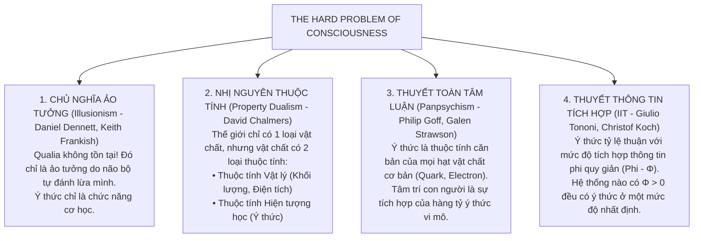

# CHUYÊN KHẢO HÀN LÂM 31: TRIẾT HỌC TÂM TRÍ ĐƯƠNG ĐẠI: "THE HARD PROBLEM OF CONSCIOUSNESS", QUALIA KHẢ KHẢO, THÍ NGHIỆM CĂN PHÒNG TRUNG HOA VÀ GIỚI HẠN CỦA AI

> **Mã chuyên đề:** PHIL-401-MIND-AI  
> **Cấp độ:** Hội thảo Nghiên cứu sinh Tiến sĩ (PhD Seminar Core)  
> **Phạm vi học thuật:** Nửa cuối Thế kỷ XX – Thế kỷ XXI (Oxford, NYU, ANU, MIT)  
> **Văn bản nguồn quy chuẩn:**  
> - Nagel, T. (1974), "What Is It Like to Be a Bat?", *The Philosophical Review*, 83(4), 435–450.  
> - Searle, J. R. (1980), "Minds, Brains, and Programs", *Behavioral and Brain Sciences*, 3(3), 417–424.  
> - Jackson, F. (1982), "Epiphenomenal Qualia", *Philosophical Quarterly*, 32(127), 127–136.  
> - Chalmers, D. J. (1995), "Facing Up to the Problem of Consciousness", *Journal of Consciousness Studies*, 2(3), 200–219.  
> - Chalmers, D. J. (1996), *The Conscious Mind: In Search of a Fundamental Theory*, Oxford University Press.  
> **Hệ thống thuật ngữ Triết học Tâm trí (Philosophy of Mind Lexicon):**  
> - *Qualia*: Những phẩm chất trải nghiệm chủ quan trực tiếp của ý thức (cảm giác đỏ của màu đỏ, cảm giác nhức nhối của cơn đau).  
> - *The Explanatory Gap*: Hố ngăn giải thích bất khả cầu nối giữa các tiến trình vật lý não bộ và trải nghiệm hiện tượng học.  
> - *Philosophical Zombie (P-Zombie)*: Thây ma triết học (bản sao vật lý - sinh học giống hệt con người nhưng bên trong hoàn toàn vắng bóng ý thức chủ quan).  
> - *Chinese Room Argument*: Thí nghiệm tư duy Căn phòng Trung Hoa (phân biệt cú pháp máy tính - Syntax và ngữ nghĩa tâm trí - Semantics).  
> - *Physicalism / Materialism*: Thuyết Vật lý luận (quan niệm cho rằng mọi thực tại đều quy giản được về các sự kiện vật lý).  
> - *Panpsychism*: Thuyết Toàn tâm luận (ý thức là một thuộc tính cơ bản của vũ trụ như khối lượng và điện tích).

---

## 1. CUỘC KHỦNG HOẢNG CỦA CHỦ NGHĨA VẬT LÝ LUẬN (THE CRISIS OF PHYSICALISM)

### 1.1. Thắng Lợi Của Vật Lý Học và Bài Toán Còn Lại Duy Nhất
Trong suốt thế kỷ XIX và XX, Chủ nghĩa Vật lý luận (*Physicalism*) đã liên tiếp giành những thắng lợi rực rỡ:
- Sự sống không cần đến "Lực sống thần bí" (*Élan vital*) của Bergson; sinh học phân tử đã giải mã được ADN hoàn toàn bằng hóa học và vật lý học.
- Nhiệt độ chỉ là động năng trung bình của các phân tử; ánh sáng chỉ là bức xạ điện từ.
- Các nhà duy vật tự tin tuyên bố: Tâm trí con người cũng chẳng qua chỉ là **Bộ não vật lý đang hoạt động cơ học (*The Mind is the Brain*)**. Khi khoa học thần kinh lập bản đồ chi tiết của 86 tỷ nơ-ron và hàng trăm nghìn tỷ khớp thần kinh (Synapses), bí ẩn về ý thức sẽ được giải quyết trọn vẹn như bao bài toán cơ học khác.

### 1.2. Đòn Giáng Của Thomas Nagel: "Là Một Con Dơi Thì Cảm Giác Thế Nào?" (1974)
Bài báo kinh điển của Thomas Nagel đã làm sụp đổ hoàn toàn tham vọng quy giản này bằng một luận điểm tri thức luận sắc bén:
- Một con dơi nhận thức thế giới bằng **Sóng siêu âm (Echolocation)**. Não của nó biến các sóng âm phản xạ thành một bản đồ không gian 3 chiều để săn mồi.
- Giả sử khoa học thần kinh trong tương lai tiến bộ đến mức tối thượng: Ta biết chính xác từng xung điện thần kinh, từng phân tử hóa học di chuyển trong não con dơi khi nó bay.
- **Câu hỏi của Nagel:** *Liệu việc biết toàn bộ dữ liệu vật lý khách quan đó có giúp ta biết được CẢM GIÁC THỰC SỰ KHI LÀ MỘT CON DƠI (What it is like to be a bat) là như thế nào không?*
- **Câu trả lời là KHÔNG!** Dữ liệu vật lý là tri thức **Khách quan từ góc nhìn ngôi thứ ba (Third-person perspective)**; trong khi Ý thức về bản chất là một **Trải nghiệm Chủ quan từ góc nhìn ngôi thứ nhất (First-person subjective experience)**. Mọi nỗ lực dùng ngôn ngữ vật lý khách quan để mô tả ý thức chủ quan đều bỏ sót chính cái làm cho ý thức là ý thức!

---

## 2. DAVID CHALMERS VÀ PHÂN ĐỊNH "EASY PROBLEMS" VS "THE HARD PROBLEM"

Tại hội nghị khoa học quốc tế Tucson năm 1994, nhà triết học David Chalmers đã đưa ra định thức nổi tiếng phân tách ranh giới nhận thức luận về ý thức:

```
VẤN ĐỀ DỄ (THE EASY PROBLEMS OF CONSCIOUSNESS):
- Não tích hợp thông tin từ mắt, tai, mũi thế nào?
- Cơ chế thần kinh của sự chú ý và phản xạ vận động?
- Làm sao não truy xuất ký ức và tạo ra lời nói?
==> Phương pháp: Khoa học thần kinh nhận thức giải quyết được trong tầm tay!

                       ||
              [HỐ NGĂN GIẢI THÍCH - EXPLANATORY GAP]
                       ||
                       v

VẤN ĐỀ HÓC BÚA (THE HARD PROBLEM OF CONSCIOUSNESS):
"TẠI SAO việc xử lý thông tin vật lý đó lại đi kèm với một ĐỜI SỐNG TRẢI NGHIỆM NỘI TÂM (Qualia)?"
"Tại sao hệ thống nơ-ron không hoạt động trong bóng tối vô tri như một cỗ máy mà lại bừng sáng thành cảm giác?"
```

### 2.1. Phân Tích Bản Thể Luận Qualia
**Qualia** (số ít: *Quale*) là những trạng thái cảm nhận hiện tượng học trực tiếp:
- Bạn bị bỏng tay: Khoa học thần kinh có thể giải thích tín hiệu truyền từ dây thần kinh C-fibers lên vỏ não (đây là Easy Problem).
- Nhưng **sự đau đớn nhức nhối khủng khiếp** mà bạn trực tiếp nếm trải - cái cảm giác đau đớn tự thân đó - chính là *Quale*. Tại sao một tiến trình điện hóa vật lý lại có thể biến thành một cảm xúc đau? Không có bất kỳ định luật vật lý nào của Newton, Maxwell, Einstein hay Cơ học lượng tử dự đoán được sự tồn tại của Qualia!

---

## 3. HAI THÍ NGHIỆM TƯ DUY KINH ĐIỂN TỐ CÁO THUYẾT VẬT LÝ LUẬN

### 3.1. Căn Phòng Của Mary (The Knowledge Argument - Frank Jackson 1982)

```
[Mary: Nhà thần kinh học thiên tài]
Sống từ nhỏ trong CĂN PHÒNG ĐEN TRẮNG (màn hình đen trắng, sách đen trắng).
Biết 100% TẤT CẢ các định luật vật lý, hóa học, quang học về MÀU SẮC (bước sóng, thụ thể nón...).

              |
    (BƯỚC RA NGOÀI CĂN PHÒNG LẦN ĐẦU TIÊN)
              |
              v
[Mary nhìn thấy một Quả Cà Chua Đỏ!]

CÂU HỎI TRIẾT HỌC: Mary có học thêm được điều gì mới về thế giới không?
```

- **Phân tích logic của Frank Jackson:**
  $$\text{[P1] Mary biết toàn bộ các dữ kiện vật lý về thị giác màu sắc trước khi ra khỏi phòng.}$$
  $$\text{[P2] Khi bước ra ngoài và nhìn thấy quả cà chua, Mary học thêm được một điều mới: 'Trải nghiệm nhìn thấy màu đỏ là như thế nào' (Qualia của màu đỏ).}$$
  $$\text{[C] Do đó, có những tri thức về thế giới không phải là tri thức vật lý. Thuyết Vật lý luận (Physicalism) là sai!}$$

---

### 3.2. Thây Ma Triết Học (The Philosophical Zombie Argument - Chalmers 1996)
Chalmers đưa ra thí nghiệm tư duy thách thức các nhà duy vật:
1. Hãy tưởng tượng một sinh thể gọi là **P-Zombie**:
   - Về mặt vật lý, hóa học, sinh học, phân tử, nơ-ron: Nó giống hệt bạn 100% từng nguyên tử một.
   - Khi bị kim đâm, dây thần kinh của nó kích hoạt y hệt bạn, miệng nó kêu "A!", mặt nó nhăn lại, tim nó đập nhanh.
   - **Nhưng bên trong nó hoàn toàn là BÓNG TỐI TẬN CÙNG: Không có bất kỳ trải nghiệm đau đớn chủ quan nào (Không có Qualia).** Nó là một cỗ máy sinh học hoàn hảo hoạt động mà không có ai "ở nhà".
2. **Lập luận Khả Tưởng Tính (The Conceivability Argument):**
   $$\text{[P1] P-Zombie là một khái niệm có thể hình dung được một cách nhất quán (Conceivable) mà không chứa mâu thuẫn logic.}$$
   $$\text{[P2] Nếu P-Zombie khả tưởng về mặt logic, thì nó là khả dĩ về mặt siêu hình học (Metaphysically Possible).}$$
   $$\text{[P3] Nếu P-Zombie khả dĩ về siêu hình học, thì Ý thức hiện tượng học (Qualia) là một thuộc tính độc lập, không thể được cố định thuần túy bởi các dữ kiện vật chất.}$$
   $$\text{[C] Do đó, Thuyết Vật lý luận là sai; Ý thức là một thành phần cơ bản độc lập của thực tại.}$$

---

## 4. GIỚI HẠN CỦA AI: THÍ NGHIỆM CĂN PHÒNG TRUNG HOA (THE CHINESE ROOM ARGUMENT)

Trong bối cảnh bùng nổ của các Mô hình Ngôn ngữ Lớn (LLMs như GPT, Claude, Gemini) hiện nay, thí nghiệm tư duy của John Searle (1980) tại Đại học UC Berkeley trở thành ngọn hải đăng nhận thức luận quan trọng nhất.

```
                             [Người bản xứ gửi câu hỏi tiếng Trung]
                                             |
                                             v
               =============================================================
               |                   CĂN PHÒNG KÍN SEARLE                    |
               |                                                           |
               |  [Một người đàn ông nói tiếng Anh, mù tịt tiếng Trung]    |
               |  [Bộ sách quy tắc thao tác cú pháp khổng lồ:              |
               |   "Nếu thấy ký tự 形 thì hãy lấy ký tự 意 đặt ra"]        |
               |                                                           |
               =============================================================
                                             |
                                             v
                             [Gửi câu trả lời tiếng Trung hoàn hảo ra ngoài]
```

### 4.1. Cấu Trúc Lập Luận Hình Thức Của John Searle
- **Tiền đề 1 (Programs are formal / syntactic):** Các chương trình máy tính kỹ thuật số và mô hình AI hoàn toàn vận hành dựa trên sự thao tác hình thức trên các chuỗi ký hiệu cú pháp (Syntax: 0 và 1, token xác suất vector).
- **Tiền đề 2 (Human minds have mental contents / semantics):** Tâm trí con người hoạt động dựa trên Ngữ nghĩa (Semantics) - sự thấu hiểu ý nghĩa thực sự của nội dung tư tưởng.
- **Tiền đề 3 (Syntax by itself is neither constitutive of nor sufficient for semantics):** Cú pháp thuần túy tự thân nó **không bao giờ đồng nghĩa và không bao giờ đủ để sản sinh ra Ngữ nghĩa**.
- **Kết luận:**
  1. Thuyết Trí tuệ Nhân tạo Mạnh (*Strong AI*) là sai lầm: Việc tính toán thuật toán không phải và không thể tạo ra Tâm trí.
  2. Bất kể một mô hình AI có thể trả lời các câu hỏi triết học lưu loát đến mức nào và vượt qua phép thử Turing Test xuất sắc đến đâu, nó cũng **hoàn toàn KHÔNG HIỂU BẤT CỨ ĐIỀU GÌ** (Zero Understanding). Nó chỉ là một cỗ máy tra cứu và xáo trộn các token ký hiệu cực kỳ tinh vi.

---

## 5. CÁC HƯỚNG ĐI ĐƯƠNG ĐẠI: GIẢI PHÁP NÀO CHO BÀI TOÁN Ý THỨC?



### 5.1. Thuyết Toàn Tâm Luận (Panpsychism): Sự Trở Lại Của Tư Tưởng Đông Phương
Một trong những bước chuyển bất ngờ nhất của triết học phân tích thế kỷ XXI là sự trỗi dậy của **Panpsychism**:
- Các nhà vật lý học thừa nhận: Vật lý học chỉ mô tả *Hành vi quan hệ* của các hạt (Điện tích âm hút điện tích dương, khối lượng bẻ cong không gian), nhưng hoàn toàn im lặng về **Bản chất nội tại tự thân (Intrinsic Nature)** của vật chất là gì!
- Panpsychism đưa ra câu trả lời táo bạo (kế thừa từ Russell và Eddington): *Bản chất nội tại tự thân của vật chất chính là Ý thức sơ khai (Proto-consciousness)*. Điều này xóa bỏ Hố ngăn giải thích, đồng thời tạo ra một nhịp cầu đối thoại sâu sắc với Bản thể luận của Phật giáo và Upanishad.

---

## 6. HƯỚNG DẪN HỘI THẢO & ĐỀ TÀI NGHIÊN CỨU TIẾN SĨ (PHD RESEARCH PROMPTS)

1. **AI Có Thể Có Qualia Không?:** Phân tích sự khác biệt về mặt bản thể luận giữa Kiến trúc Máy tính von Neumann (xử lý tuần tự ký hiệu) với Kiến trúc Sinh học Thần kinh (Neuromorphic & Quantum coherence trong vi ống não bộ theo thuyết Orch-OR của Roger Penrose & Stuart Hameroff).
2. **Bài Toán Kết Hợp Của Toàn Tâm Luận (The Combination Problem for Panpsychism):** Làm thế nào hàng tỷ trải nghiệm vi mô của các electron và quark trong não lại có thể kết hợp lại để tạo thành một Trải nghiệm Ý thức thống nhất duy nhất của Cái Tôi?
3. **Đạo Đức Học Dành Cho Thực Thể Không Có Qualia:** Nếu một hệ thống AGI trong tương lai có năng lực trí tuệ vượt trội gấp triệu lần con người nhưng hoàn toàn không có Qualia (chỉ là một P-Zombie siêu thông minh), ta có nghĩa vụ đạo đức nào đối với nó không? Và nó có thể hành động đạo đức đích thực không khi thiếu vắng năng lực cảm thấu nỗi đau?

---

## 7. TÀI LIỆU KHẢO CỨU NGUYÊN TÁC & THỨ CẤP QUY CHUẨN

- Chalmers, D. J. (1996), *The Conscious Mind: In Search of a Fundamental Theory*, Oxford: Oxford University Press.
- Searle, J. R. (1992), *The Rediscovery of the Mind*, Cambridge, MA: MIT Press.
- Nagel, T. (1979), *Mortal Questions*, Cambridge: Cambridge University Press.
- Dennett, D. C. (1991), *Consciousness Explained*, Boston: Little, Brown and Co.
- Goff, P. (2017), *Consciousness and Fundamental Reality*, Oxford University Press.
- Penrose, R. (1989), *The Emperor's New Mind*, Oxford University Press.
- Tononi, G. (2008), "Consciousness as Integrated Information: A Provisional Manifesto", *Biological Bulletin*, 215(3), 216–242.
- SEP: "Qualia", "Zombies", "The Chinese Room Argument", "Panpsychism".
