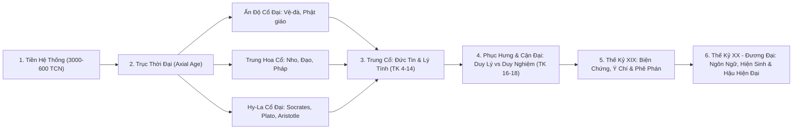
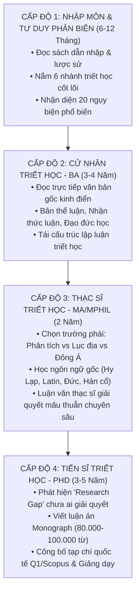

# Tổng Hợp Kiến Thức Triết Học Theo Biên Niên Sử & Lộ Trình Học Thuật (Nhập Môn → Tiến Sĩ)

> **Tài liệu tham chiếu chuẩn hóa học thuật**  
> Dựa trên biên niên sử tài liệu triết học nhân loại (Phương Tây, Phương Đông, Việt Nam).  
> Tích hợp cùng [Interactive Dashboard Lộ Trình](file:///C:/Users/Administrator/.gemini/antigravity/brain/32edf000-ce47-4c63-a802-3361d06f5ba6/philosophy_roadmap_dashboard.html).

---

## PHẦN I: TỔNG HỢP KIẾN THỨC THEO BIÊN NIÊN SỬ TƯ TƯỞNG

Lịch sử triết học nhân loại là cuộc hành trình từ **Thần thoại (Mythos)** sang **Lý tính (Logos)**, từ truy vấn bản thể vũ trụ đến phê phán cấu trúc nhận thức, quyền lực và sự hiện sinh của con người.

---

### 1. Thời kỳ Trước triết học hệ thống (Khoảng 3000 – 600 TCN)
* **Khu vực:** Ai Cập, Lưỡng Hà, Ba Tư, Ấn Độ sơ kỳ, Trung Hoa sơ kỳ.
* **Tác phẩm tiêu biểu:** *Sử thi Gilgamesh*, *Lời dạy của Ptahhotep*, *Rigveda*, *Kinh Dịch* (thoái quái), *Avesta*.
* **Vấn đề trung tâm:** Nguồn gốc thế giới, trật tự vũ trụ, cái chết, tính hữu hạn của con người, sự phân định Thiện - Ác.
* **Ý nghĩa:** Chuyển giao nhận thức: từ cúng tế thần linh sang nhận thức quy luật tự nhiên và trách nhiệm đạo đức.

---

### 2. Triết học Ấn Độ cổ đại
* **Vệ-đà & Ấn Độ giáo:** Phổ quát hóa thực tại tối thượng qua cặp phạm trù **Brahman** (Bản thể vũ trụ) và **Atman** (Chân ngã / Tự tính). Hành động gắn liền với Luật Nghiệp (*Karma*) và Luân hồi (*Samsara*). Tác phẩm đỉnh cao: *Upanishad*, *Bhagavad Gita*.
* **Phật giáo (Buddhism):** Phá vỡ quan niệm về một tự ngã bất biến (Học thuyết **Vô ngã - Anatman**, **Vô thường - Anicca**, **Duyên khởi - Pratityasamutpada**).
  - *Đại thừa & Long Thọ (Nagarjuna):* Khai triển khái niệm **Tính Không (Sunyata)** trong *Trung luận*, vượt qua nhị biên có/không.
  - *Duy Thức Tông (Vô Trước, Thế Thân):* Khám phá cơ chế nhận thức của tâm thức (Tàng thức - Alayavijnana).
* **Các trường phái đối trọng:** *Nyaya* (Logic & nhận thức luận), *Samkhya* (Nhị nguyên Tinh thần - Vật chất), *Carvaka* (Duy vật & hoài nghi luận triệt để).

---

### 3. Triết học Trung Hoa cổ đại (Thời kỳ Bách Gia Chư Tử)
* **Nho gia (Khổng Tử, Mạnh Tử, Tuân Tử):** Trọng tâm là trật tự xã hội và nhân tính. Khổng Tử đề cao *Nhân - Lễ - Chính danh*; Mạnh Tử chủ trương *Tính thiện* và vương đạo; Tuân Tử đề cao *Tính ác* và giáo hóa bằng lễ chế.
* **Đạo gia (Lão Tử, Trang Tử):** Đặt nền tảng trên **Đạo** (nguyên lý huyền đồng vô hình sinh thành vũ trụ) và **Vô vi** (hành động thuận theo tự nhiên). Trang Tử phát triển thuyết tương đối về nhận thức và tự do tinh thần tuyệt đối.
* **Pháp gia (Hàn Phi Tử):** Đoạn tuyệt đạo đức lý tưởng, xây dựng học thuyết quyền lực thực tế dựa trên **Thế - Thuật - Pháp**.
* **Phát triển sau này:** Huyền học Ngụy-Tấn (Vương Bật), Tân Nho giáo Tống-Minh (Chu Hy nhấn mạnh "Lý", Vương Dương Minh đề cao "Tâm học" và "Tri hành hợp nhất").

---

### 4. Hy Lạp và La Mã cổ đại
* **Tiền Socrates:** Truy tìm bản nguyên (*Arche*): Thales (Nước), Anaximander (Apeiron), Heraclitus (Lửa & Biến dịch/Logos), Parmenides (Hữu thể bất biến), Democritus (Nguyên tử luận).
* **Plato & Socrates:** Socrates dùng phương pháp đỡ đẻ tinh thần (*Elenchus*). Plato phân chia thực tại thành hai thế giới: *Thế giới khả giác* (bóng ảo) và *Thế giới ý niệm/mẫu mực* (Forms). Tác phẩm: *Cộng hòa*, *Symposium*.
* **Aristotle:** Phê phán thế giới ý niệm siêu nghiệm của Plato; xây dựng hệ thống logic học (*Organon*), siêu hình học cứu cánh (*Teleology*), và đạo đức đức hạnh trung dung (*Golden Mean*).
* **Chủ nghĩa Khắc kỷ (Stoicism) & Epicurus:** Triết lý thực hành tìm kiếm sự bình thản tâm hồn (*Ataraxia*). Khắc kỷ (Seneca, Epictetus, Marcus Aurelius) chấp nhận vận mệnh (*Amor Fati*); Epicurus hướng đến khoái lạc tinh thần thanh thản và tiết độ.

---

### 5. Triết học Trung Cổ: Kitô giáo, Do Thái & Hồi giáo
* **Chủ đề chính:** Mối quan hệ giữa **Đức tin (Faith)** và **Lý tính (Reason)**.
* **Augustine (TK IV-V):** Dung hợp tư tưởng Tân Plato vào thần học Kitô giáo; luận thuyết về thời gian, ân sủng và cuộc chiến giữa Thành đô trần thế và Thành đô Thiên Chúa.
* **Thomas Aquinas (TK XIII):** Đỉnh cao kinh viện học (Scholasticism), dung hợp Aristotle vào Kitô giáo qua bộ *Tổng luận thần học*.
* **Triết học Hồi giáo (Hoàng kim Hồi giáo):** Bảo lưu, bình chú và phát triển di sản Hy Lạp: Al-Farabi, Avicenna (Ibn Sina - Luận về hữu thể và y học), Averroes (Ibn Rushd - Thuyết hai chân lý), Ibn Khaldun (Sử học & xã hội học triết lý).
* **William of Ockham:** Thuyết duy danh (*Nominalism*) và nguyên lý tiết kiệm giả thuyết (**Dao cạo Ockham**), mở đường cho khoa học thực nghiệm cận đại.

---

### 6. Thời kỳ Phục Hưng & Khai Sáng Cận Đại
* **Cách mạng khoa học & Triết học chính trị:** Machiavelli tách chính trị khỏi đạo đức (*Quân vương*); Francis Bacon đề xướng phương pháp quy nạp (*Novum Organum*); Thomas Hobbes (*Leviathan*) đề ra học thuyết Khế ước xã hội.
* **Chủ nghĩa Duy lý (Continental Rationalism):**
  - **Descartes:** Hoài nghi phương pháp luận, nguyên lý *"Cogito, ergo sum"* (Tôi tư duy, nên tôi tồn tại), thuyết nhị nguyên tâm - vật.
  - **Spinoza:** Nhất nguyên luận bản thể (*Deus sive Natura* - Thượng đế hay Tự nhiên).
  - **Leibniz:** Thuyết đơn tử (*Monadology*), thế giới hoàn hảo nhất có thể.
* **Chủ nghĩa Duy nghiệm (British Empiricism):**
  - **John Locke:** Tâm trí như tấm bảng trắng (*Tabula Rasa*), nguồn gốc tri thức từ cảm giác.
  - **David Hume:** Hoài nghi luận triệt để về quan hệ nhân quả và bản ngã.
* **Cuộc cách mạng Kopernik của Immanuel Kant:** Tổng hợp duy lý và duy nghiệm. Phân biệt thế giới hiện tượng (*Phenomena*) mà con người tri giác qua các phạm trù tiên nghiệm, và thế giới vật tự thân (*Noumena*). Đạo đức học mệnh lệnh tuyệt đối (*Categorical Imperative*).

---

### 7. Triết học Thế kỷ XIX: Biện chứng, Ý chí & Phê phán xã hội
* **G.W.F. Hegel:** Hệ thống duy tâm biện chứng tuyệt đối; lịch sử là quá trình Tinh thần thế giới (*Geist*) tự nhận thức chính mình qua mâu thuẫn (Chính - Phản - Hợp).
* **Karl Marx & Friedrich Engels:** Lộn ngược biện chứng Hegel thành **Chủ nghĩa duy vật biện chứng** và **Duy vật lịch sử**. Động lực lịch sử là quan hệ sản xuất và đấu tranh giai cấp; phê phán tha hóa lao động trong *Tư bản*.
* **Søren Kierkegaard:** Cha đẻ của Thuyết hiện sinh tôn giáo; trải nghiệm lo âu (*Angst*), bước nhảy đức tin vượt lên đạo đức xã hội.
* **Friedrich Nietzsche:** Tuyên bố *"Thượng đế đã chết"*, phê phán đạo đức nô lệ của Kitô giáo, đề xướng Ý chí quyền lực (*Wille zur Macht*) và hình mẫu Siêu nhân (*Übermensch*).

---

### 8. Triết học Thế kỷ XX đến Đương Đại
* **Nhánh Triết học Phân tích (Analytic Philosophy):**
  - Trọng tâm: Logic, ngôn ngữ và khoa học.
  - Đại diện: Frege, Russell, Wittgenstein (Giai đoạn *Tractatus* nhấn mạnh ranh giới cái có thể nói; giai đoạn *Cuộc điều tra triết học* mở ra khái niệm "Trò chơi ngôn ngữ"), Karl Popper (Nguyên lý khả bác sai).
* **Nhánh Triết học Lục địa (Continental Philosophy):**
  - **Hiện tượng học & Hiện sinh:** Edmund Husserl (Trở về với chính sự vật), Martin Heidegger (Vấn đề hữu thể, *Dasein*, lo âu trước cái chết), Jean-Paul Sartre ("Hiện sinh có trước bản chất"), Albert Camus (Tính phi lý).
  - **Hậu cấu trúc & Giải cấu trúc:** Michel Foucault (Mối quan hệ quyền lực - tri thức - thể chế), Jacques Derrida (Giải cấu trúc văn bản).
  - **Lý thuyết phê phán:** Trường phái Frankfurt (Adorno, Horkheimer, Habermas).
* **Triết học Đạo đức - Chính trị đương đại:** John Rawls (*Lý thuyết về công lý* với Bức màn vô tri - Veil of Ignorance), Robert Nozick (Chủ nghĩa tự do cá nhân).

---

### 9. Dòng chảy Tư tưởng & Triết học Việt Nam
* **Đặc trưng:** Triết học Việt Nam không xây dựng các hệ thống siêu hình học trừu tượng kinh viện mà mang tính **thực tiễn, dung hợp và gắn chặt với số phận dân tộc**.
* **Tam giáo đồng nguyên & Thiền phái Trúc Lâm (Thời Lý - Trần):** Vua Trần Thái Tông (*Khóa hư lục*), Trần Nhân Tông (Trúc Lâm Yên Tử), Tuệ Trung Thượng Sĩ kết hợp tinh thần giải thoát của Thiền tông với trách nhiệm nhập thế giữ nước và an dân.
* **Tư tưởng Nhân nghĩa & Khai phóng (Thời Hậu Lê & Tây Sơn):** Nguyễn Trãi (*Bình Ngô đại cáo* - "Việc nhân nghĩa cốt ở yên dân"); Lê Quý Đôn (*Vân đài loại ngữ* - hệ thống hóa bách khoa tri thức phương Đông); Ngô Thì Nhậm (Dung hợp Nho - Phật).
* **Thời kỳ Canh tân & Hiện đại hóa (Cuối TK XIX - Đầu TK XX):** Nguyễn Trường Tộ, Phan Bội Châu, Phan Châu Trinh (Dân quyền, khai dân trí, chấn dân khí).
* **Tiếp biến Triết học Thế giới:** Trần Đức Thảo (Nhà hiện tượng học và Mác-xít tầm vóc quốc tế với tác phẩm đối thoại trực tiếp cùng Sartre và Merleau-Ponty); Tư tưởng Hồ Chí Minh (Vận dụng sáng tạo chủ nghĩa Marx - Lenin gắn liền với độc lập dân tộc và giải phóng con người).

---

## PHẦN II: LỘ TRÌNH HỌC TRIẾT HỌC 4 CẤP BẬC (NHẬP MÔN → TIẾN SĨ)

---

### CẤP ĐỘ 1: NHẬP MÔN & TƯ DUY PHẢN BIỆN (Introductory / Self-Taught)
* **Thời gian dự kiến:** 6 – 12 tháng.
* **Mục tiêu đạt được:** 
  1. Hiểu được "Bản đồ thời gian" của tư tưởng nhân loại (ai đi trước ai, ai phản biện ai).
  2. Nắm vững thuật ngữ căn bản (Bản thể, Nhận thức, Tiên nghiệm, Hữu thể, Biện chứng, Duyên khởi...).
  3. Làm chủ Logic hình thức cơ bản và nhận diện các lỗi ngụy biện thường gặp.
* **Chương trình đọc đề xuất:**
  - *Thế giới của Sophie* (Jostein Gaarder) – khung truyện dẫn nhập triết học Tây phương.
  - *Câu chuyện triết học* (Will Durant) – văn phong văn học xuất sắc về các đại triết gia.
  - *Ba mươi triết gia Tây phương* (Nguyễn Ước).
  - *Thuật tư tưởng* & *Óc sáng suốt* (Thu Giang Nguyễn Duy Cần) – rèn luyện tâm thế tiếp cận triết học phương Đông.
  - Các đoạn đối thoại mở đầu của Plato: *Biện hộ của Socrates*, *Euthyphro*, *Crito*.

---

### CẤP ĐỘ 2: CỬ NHÂN TRIẾT HỌC (Bachelor of Arts - BA Standard)
* **Thời gian dự kiến:** 3 – 4 năm.
* **Mục tiêu đạt được:** 
  1. Đọc hiểu trực tiếp các văn bản nguồn (*Primary Texts*) mà không phụ thuộc hoàn toàn vào sách tóm tắt.
  2. Nắm vững cấu trúc 6 phân nhánh chính: Siêu hình học, Nhận thức luận, Đạo đức học, Triết học chính trị, Logic học, Triết học phương Đông.
  3. Khả năng viết tiểu luận học thuật (Argumentative Philosophy Paper) bảo vệ một luận điểm chặt chẽ.
* **Danh mục tác phẩm kinh điển bắt buộc:**
  1. **Cổ đại:** Plato (*Cộng hòa*); Aristotle (*Đạo đức Nicomachean*, trích đoạn *Siêu hình học*); Khổng Tử (*Luận Ngữ*); Lão Tử (*Đạo Đức Kinh*); Long Thọ (*Trung luận*).
  2. **Cận đại:** René Descartes (*Suy niệm siêu hình học*); Baruch Spinoza (*Đạo đức học*); David Hume (*Khảo luận về bản tính con người*); Immanuel Kant (*Phê phán lý tính thuần túy* - phần Nhập môn & Thẩm mỹ siêu nghiệm).
  3. **Thế kỷ XIX:** Hegel (Dẫn nhập *Hiện tượng học tinh thần*); Karl Marx (*Bản thảo kinh tế - triết học 1844*); J.S. Mill (*Bàn về tự do*); Friedrich Nietzsche (*Bàn về phả hệ đạo đức*).
  4. **Việt Nam:** Trần Thái Tông (*Khóa hư lục*), Nguyễn Trãi (*Quân trung từ mệnh tập*).

---

### CẤP ĐỘ 3: THẠC SĨ TRIẾT HỌC (Master of Arts - MA / MPhil)
* **Thời gian dự kiến:** 2 năm.
* **Mục tiêu đạt được:**
  1. Định hình ngã rẽ chuyên môn hóa (Chủ nghĩa Phân tích, Hiện tượng học - Thông diễn học, Triết học Mác-xít, hay Triết học Đông phương).
  2. Làm chủ văn bản bằng ngôn ngữ nguyên tác: Yêu cầu tối thiểu biết dịch và tra cứu một ngôn ngữ triết học (Hy Lạp cổ, Latin, Tiếng Đức, Tiếng Pháp, Tiếng Phạn hoặc Chữ Hán cổ).
  3. Hoàn thành Luận văn Thạc sĩ giải quyết một vấn đề diễn giải lịch sử hoặc tranh luận khái niệm giữa hai học giả.
* **Chuyên đề nghiên cứu sâu:**
  - *Nhánh Phân tích:* Gottlob Frege (*Ý nghĩa và vật chỉ quy*), Ludwig Wittgenstein (*Tractatus Logico-Philosophicus* và *Nghiên cứu triết học*), W.V.O. Quine (*Hai giáo điều của chủ nghĩa kinh nghiệm*).
  - *Nhánh Lục địa:* Edmund Husserl (*Ý niệm I*), Martin Heidegger (*Hữu thể và thời gian*), Jean-Paul Sartre (*Hữu thể và hư vô*), Maurice Merleau-Ponty (*Hiện tượng học tri giác*).
  - *Lý thuyết văn hóa & Hậu hiện đại:* Michel Foucault (*Khảo cổ học tri thức*, *Giám sát và trừng phạt*), Jacques Derrida (*Về ngữ pháp học*), Jürgen Habermas (*Lý thuyết hành động giao tiếp*).
  - *Triết học Việt Nam:* Trần Đức Thảo (*Tìm kiếm nguồn gốc ngôn ngữ và ý thức*).

---

### CẤP ĐỘ 4: TIẾN SĨ TRIẾT HỌC (Doctor of Philosophy - PhD)
* **Thời gian dự kiến:** 3 – 5 năm.
* **Mục tiêu đạt được:**
  1. **Kiến tạo tri thức mới (Original Contribution to Knowledge):** Không dừng lại ở việc tổng thuật hay tóm tắt người khác, mà đưa ra được một khung lý thuyết, một lời giải mới cho nghịch lý triết học chưa có đáp án, hoặc phát hiện một cách đọc mới đối với văn bản kinh điển.
  2. Viết và bảo vệ thành công **Luận án Tiến sĩ (Dissertation / Monograph)** dung lượng khoảng 80.000 – 100.000 từ trước hội đồng bình duyệt đồng cấp quốc tế.
  3. Công bố ít nhất 2 – 3 bài báo trên các tạp chí triết học hàng đầu (Peer-reviewed Q1/A&HCI như *Mind*, *The Philosophical Review*, *Synthese*, *Philosophy and Phenomenological Research*, *Journal of Chinese Philosophy*).

#### Các hướng đề tài nghiên cứu Tiến sĩ mũi nhọn hiện nay:
1. **Triết học Tâm trí & Trí tuệ Nhân tạo (Philosophy of Mind & AI Ethics):**
   - Vấn đề ý thức máy móc, trải nghiệm chủ quan (*Qualia*), đạo đức thuật toán tự hành, trách nhiệm hiện sinh khi AGI xuất hiện.
2. **Triết học So sánh Đông - Tây (Comparative Philosophy):**
   - Đối thoại giữa Tính Không (Phật giáo) và Hư vô luận phương Tây; So sánh đạo đức đức hạnh của Aristotle với Nho gia; Tâm học Vương Dương Minh với Hiện tượng học Husserl.
3. **Triết học Chính trị & Công lý Phân phối Đương đại:**
   - Đạo đức sinh học (Bioethics), khủng hoảng sinh thái toàn cầu (Environmental Philosophy), chủ quyền số và quyền riêng tư dữ liệu.
4. **Nghiên cứu Chuyên sâu Tư tưởng Việt Nam:**
   - Hệ thống hóa tư tưởng triết học thời Lý - Trần dưới lăng kính hiện đại; Phân tích đóng góp hiện tượng học của Trần Đức Thảo trong đối thoại với triết học Pháp TK XX.

---

## PHẦN III: PHƯƠNG PHÁP & CÔNG CỤ XÂY DỰNG "BỘ NÃO THỨ HAI" (SECOND BRAIN) CHO NGHIÊN CỨU TRIẾT HỌC

Để tiến từ người đọc bình thường lên tầm nghiên cứu sinh Tiến sĩ, bạn không thể đọc thụ động. Cần thiết lập hệ thống ghi chép **Zettelkasten / Obsidian**:

1. **Fleeting Notes (Ghi chú lướt):** Ghi lại lập tức ý tưởng, thắc mắc khi đang đọc.
2. **Literature Notes (Ghi chú tư liệu):** Tóm tắt lập luận của tác giả bằng chính từ ngữ của bạn, kèm số trang và citation chính xác.
3. **Permanent Notes (Ghi chú vĩnh cửu):** Một ghi chú = Một khái niệm triết học nguyên tử (Atomic Concept). Ví dụ: `Dasein-Heidegger.md`, `Dao-Cao-Ockham.md`.
4. **MOC (Map of Content - Bản đồ nội dung):** Liên kết các ghi chú nguyên tử lại theo từng vấn đề lớn (ví dụ: Bản thể luận, Tự do ý chí, Vấn đề Thân - Tâm).

---
*Tài liệu được khởi tạo và lưu trữ phục vụ nghiên cứu triết học học thuật dài hạn.*
